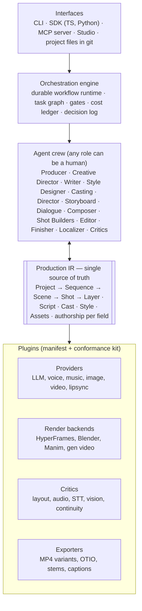
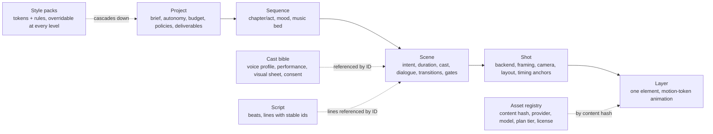
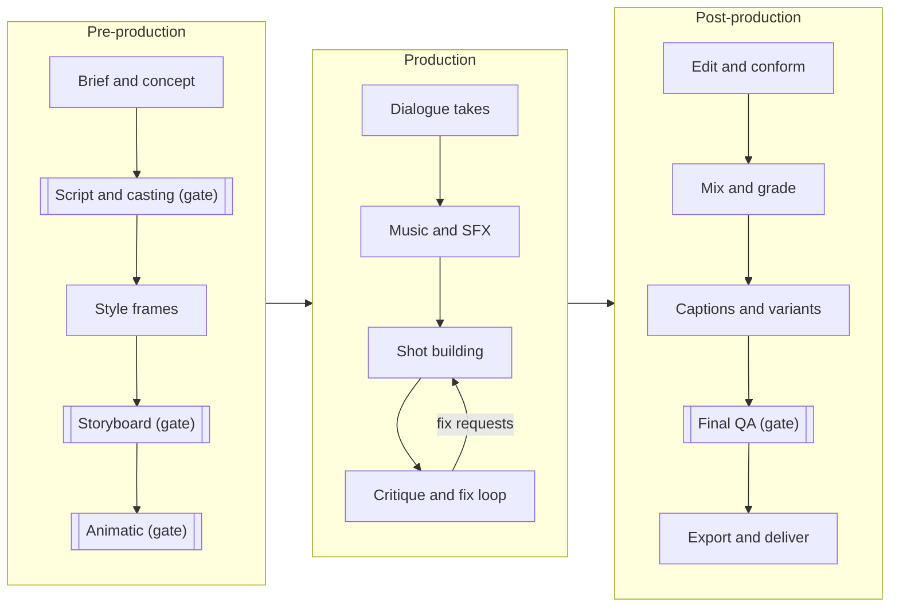

# Cinewright — Architecture & Design Spec

> Exported 2026-11-12 from the living design doc ("Open Video Production Framework — Architecture & Design Spec"). The living doc is the source of truth until this repo exists; after that, this file is, and changes go through RFCs. Cinewright is the approved working name (D1).

Nov 11, 2026 · @Jeremy Tsai

## Summary

**The framework is an open-source, agent-driven production pipeline that models video the way a studio does — project, sequences, scenes, shots, layers, a cast and a style system — and lets humans or agents author any part of it at any level of detail.** It is not a prompt-to-clip generator; it is a production system whose agents happen to be able to fill every role.

Seven principles keep the output professional rather than templated:

1. **One production document is the source of truth.** Every decision — a shot's lens, a line's delivery, a transition's easing — lives in a typed, versioned IR. Agents and humans edit the same document; renderers only compile it.
2. **Scope is granular and lockable.** Any field at any level can be authored by the user, delegated to an agent, or locked. Agents fill only what is unlocked and unspecified.
3. **Style is a system, not a prompt.** Style packs define tokens, motion grammar, camera language, typography and sound palette; every scene inherits them through an override cascade.
4. **Cast is first-class.** Narrators and characters are entities with voice profiles, visual identity references and performance direction, reused consistently across scenes.
5. **Pre-production before production.** Script, storyboard and animatic are approved before expensive generation, exactly as in a real studio.
6. **Quality is measured, not hoped for.** Every shot passes deterministic checks and rubric critique before it can be assembled; failures loop back with targeted fixes.
7. **Everything is a plugin.** Model providers, render backends, critics, style packs and whole workflows are swappable, so the community can extend it without forking.

**Underlying all seven: the framework is neutrally professional for every request.** Development test cases and clips tuned to any one person's taste are fixtures and opt-in style packs, never defaults in core code, agent prompts or critic rubrics; merges are gated on a genre-diverse benchmark. The repo's AGENTS.md codifies this for contributors and coding agents.

## Goals, non-goals and who it serves

The framework must serve a solo creator typing one sentence and a studio team scripting every frame, with the same data model and pipeline.

**Goals**

- Broadcast-grade output: typographic, motion and audio quality a professional editor would ship.
- Multi-scene, multi-shot productions from 15 s to 20+ min, with consistent cast, look and sound across all of them.
- Any number of narrators and characters, each with their own voice, performance direction and visual identity.
- A continuous dial from fully autonomous to fully directed, settable per field, per shot, per scene.
- Many genres through one engine: motion graphics, explainers, product launches, ads, documentaries, narrative shorts, character animation, social cut-downs, localized versions.
- Interop with professional tools: timeline export to NLEs, stems for audio post, open asset formats.
- Provider-neutral and self-hostable: every external model behind an interface, local open-weight options where they exist.

**Non-goals**

- Being a frame-by-frame NLE or compositor. We generate and assemble; finishing in Resolve/Premiere is supported, not replaced.
- Training foundation models. We orchestrate them.
- Real-time or live video.

**Personas and what each needs**

| Persona | Typical ask | Needs from the framework |
| --- | --- | --- |
| Solo creator | "60 s explainer on X, energetic, two voices" | Strong defaults, style packs, full autonomy, good first draft |
| Marketing team | Product launch in 3 aspect ratios, brand-locked | Brand style pack, locked assets, approval gates, variant generation |
| Educator / doc maker | 12-min lesson with narrator + on-screen experts | Long-form structure, chapter sequences, multi-voice, captions, localization |
| Narrative storyteller | Short film with 4 characters | Cast bible, character consistency, dialogue performance, lip sync, shot language |
| Studio / agency | Pre-viz and animatics, finish in house | Fine-grained scene specs, OTIO export, stems, deterministic re-renders |
| Developer / platform | Embed generation in a product | SDK, headless API, plugin points, cost controls, batch mode |
| Plugin author | New render backend or provider | Stable plugin contracts, test kit, registry |

## Architecture at a glance



Interfaces drive the engine; agents and humans read and write only the IR; plugins turn IR into media, measurements and exports, and critic findings flow back to agents as fix requests.

## Production data model


Every authorable field at every level carries an authorship state: `open` · `agent` · `user` · `locked` (D25).

The IR is a versioned document: every agent or human change is a patch with an author and reason, so any state of the project can be diffed, reviewed, reverted or re-rendered incrementally (only shots whose resolved inputs changed are re-rendered).

## Production workflow


Gates are configurable per project (on, off, or delegated to an agent).

Pre-production is cheap (text, stills, draft TTS), so options are explored there; production renders only what the animatic locked, scenes in parallel; post assembles, mixes and versions. A revision at any point becomes an IR patch, and only the affected shots re-enter the pipeline.

## Scene scoping

**Every scene is a spec with typed fields; each field carries an authorship state — `user`, `agent`, `locked` or `open` — so a user can write one line or every detail and agents fill exactly the rest.**

### Authorship states

| State | Meaning | Agent behavior |
| --- | --- | --- |
| `open` | Unspecified | Agent may decide, must justify in the decision log |
| `agent` | Agent-authored value | Agent may revise on critique or revision |
| `user` | Human-authored or human-approved value | Agent must keep it; may *propose* changes as suggestions |
| `locked` | Frozen (approved or brand-mandated) | Untouchable; render cache reused |

Values cascade: a value set at project level (e.g. palette, narrator) is inherited by sequences, scenes, shots and layers unless overridden. Of the authorship states, only `locked` cascades: it freezes the whole subtree (D25). Overrides are explicit and visible in the Studio diff.

### Autonomy presets

Users pick a preset per project and can change it per scene:

- **Auto** — user gives a brief; agents author everything; gates only at final.
- **Guided** (default) — agents draft; user approves script, storyboard and final cut (the animatic gate joins in v0.3, when animatics exist; D38).
- **Directed** — user authors the scene list and key fields; agents fill shot-level detail.
- **Manual** — user authors the IR (through `cinewright patch`, Studio or the SDK, never by editing files; D40); agents only render and critique.

### What a scene spec holds

Shown as the readable view that `cinewright show` prints (D40), with each field's state as a trailing comment:

```yaml
scene: s03_the_problem
intent: "Show why legacy pipelines break at scale"     # user
duration: { target: 18s, flex: 15%, sync: voiceover }   # agent · shown in seconds, stored as frames (D27)
mood: [tense, building]                                 # user
style: { inherit: pack.editorial, overrides: { palette.accent: "#FF4D2E" } }   # user
cast: [narrator, dr_lin]                                # user
dialogue:                                               # lines live in the script; shown inline here (D26)
  - { who: narrator, line: "Every team hits the same wall.", direction: "[measured] low, deliberate" }
  - { who: dr_lin, line: "We rebuilt it three times.", direction: "[wry] half-laugh", on_screen: true, lipsync: true }
shots:                                                  # agent
  - id: s03.sh01                                        # agent
    type: motion_graphics          # backend: html
    framing: full_frame
    layout: { landscape: grid.12col/title-left, portrait: stack/title-top }   # per aspect class (D28)
    elements: [kinetic_title, data_bars]
    camera: { move: push_in, ease: style.motion.ease_out_expo, amount: 6% }
  - id: s03.sh02                                        # agent, except subject: user
    type: generative_footage       # backend: video-gen provider
    subject: dr_lin
    framing: medium_close, 50mm, shallow DOF
    refs: [cast.dr_lin.sheet]
transition_out: { type: match_cut, to: s04, on: "data_bars → server racks" }
sound: { music_cue: tension_rise, sfx: [whoosh_soft, tick_loop], duck_under_vo: -12dB }
gates: [storyboard, animatic]
```

The stored form wraps every authorable field as `{ value, state }` (D25). The first fields above, in a 30 fps project:

```json
{
  "id": "s03_the_problem",
  "intent":   { "value": "Show why legacy pipelines break at scale", "state": "user" },
  "duration": { "value": { "target": 540, "flex": 0.15, "sync": "voiceover" }, "state": "agent" },
  "mood":     { "value": ["tense", "building"], "state": "user" }
}
```

The same structure is reachable through natural language (Claude Code or another agent calling the CLI, later the MCP server: "make scene 3 tenser, give Dr Lin the second line"), the Studio UI, or the SDK. All of them produce the same IR patch through the IR store. The JSON files in git are the store's output, reviewed in PRs but never edited by hand (D40).

### Scoping flow per scene

1. Director agent proposes the scene list from the script (or the user supplies it).
2. For each scene, the Scene Planner expands open fields into shots with framing, layout, motion and audio cues, citing the style pack rule it applied.
3. The user reviews at the configured gate: accept, edit fields (which become `user`), lock, or ask for alternatives (N variants generated cheaply as storyboard frames).
4. Locked scenes are frozen; later edits elsewhere never re-render them unless an inherited value they depend on changes, in which case the user is warned.

## Cast and voice system

**Narrators and characters are cast entities defined once in a cast bible and referenced everywhere; each owns a voice profile, a performance style and (if on screen) a visual identity sheet, so they sound and look the same in scene 1 and scene 40.**

### Cast bible entry

Readable view (D40); stored with `{ value, state }` wrappers like every entity.

```yaml
cast:
  narrator:
    role: narrator
    voice:
      description: { language: en, timbre: "warm, mid-low", accent: neutral }   # provider-neutral (D29)
      bindings:
        elevenlabs: { voice_id: "…", model: eleven_v4, settings: { stability: 0.45 } }
        kokoro: { voice: "…" }
    performance: { baseline: "warm, confident, unhurried", pace_wpm: 150, pronunciations: { Kubernetes: "KOO-ber-NET-eez" } }
    on_screen: false
  dr_lin:
    role: character
    voice:
      description: { text: "woman, 40s, dry wit, slight rasp" }
      bindings: {}                                   # Casting designs a voice per provider and records the binding
    performance: { baseline: "wry, precise", tics: ["half-laugh before admissions"] }
    on_screen: true
    visual: { sheet: assets/cast/dr_lin/{front,profile,full}.png, wardrobe: "navy blazer", style: photoreal }
    consent: { synthetic: true }                     # vs cloned: requires consent record
```

### Voice production pipeline

1. **Casting** — for each cast member, pick a library voice, design one from a text description, or clone one with a consent record. ElevenLabs offers [instant voice cloning and voice design from text descriptions](https://elevenlabs.io/docs/capabilities/text-to-dialogue). The Casting agent generates 3 audition reads of a representative line per candidate for user selection.
2. **Script performance markup** — the Dialogue Director agent annotates each line with delivery direction. In ElevenLabs Text to Dialogue, [each turn has its own text and voice, and inline audio tags guide delivery](https://elevenlabs.io/docs/capabilities/text-to-dialogue) (e.g. \[whispers\], \[sighs\], \[excited\]). The API [recommends Eleven v4, which supports 90+ languages](https://elevenlabs.io/docs/overview/capabilities/text-to-dialogue).
3. **Generation mode per exchange**
   - *Dialogue mode* for conversations: one call renders the exchange with [natural pacing, interruptions and tone shifts](https://elevenlabs.io/blog/eleven-v3-alpha-now-available-in-the-api), then word timestamps split it into per-line clips.
   - *Per-line mode* for narration and isolated lines: each line rendered separately so it can be re-taken without disturbing neighbors.
4. **Takes and selection** — generate N takes for important lines; an audio critic (STT diff, pacing vs target WPM, loudness) shortlists; the user or Director picks. Selected takes are locked.
5. **Edit and timing** — lines are placed on per-character dialogue tracks with timestamps; scene timing snaps to them.
6. **Mix** — dialogue, music and SFX buses; ducking rules from the style pack; per-character stems exported for audio post.

### On-screen characters

- **Visual consistency**: generate a character sheet (front, profile, full body) once, then pass it as references. Veo 3.1 accepts [up to 3 reference images of a character, object or scene](https://developers.googleblog.com/en/introducing-veo-3-1-and-new-creative-controls-in-the-gemini-api) to hold consistency across shots, but [first-frame and reference-image modes cannot be combined in one request](https://help.scenario.com/articles/1049410120-veo-3-1-the-essentials) — the Shot planner must choose per shot.
- **Lip sync** as a post-pass on any shot where `lipsync: true`: Sync Labs prices [lipsync-2 at $0.04/s up to sync-3 at $0.133/s (25 fps)](https://sync.so/docs/models); [sync-3 handles extreme profiles and over-the-shoulder angles](https://sync.so/docs/models) where older models struggle. The Shot planner should favor frontal framings for lip-synced lines when using cheaper models.
- **Stylized / animated characters** (2D rigs, Lottie, Rive, 3D): driven by viseme timing from the same timestamps, rendered by the HTML or 3D backend, no generative lip sync needed.

### Voice governance

- Cloned voices require a stored consent artifact; the render gate blocks a project whose cast references a clone without one.
- Every voice asset records provider, model, plan tier and license so downstream use (streaming, broadcast) can be validated.

## Style system and creative freedom

**Look and feel come from versioned style packs — design systems for motion — that every agent must cite; freedom comes from a five-level override cascade and code-level escape hatches, so nothing is ever forced into a template.**

### What a style pack defines

| Domain | Tokens and rules (examples) |
| --- | --- |
| Color | Palette roles (bg, surface, ink, accent, data series), contrast floors, grading LUT for footage |
| Typography | Families, type scale, tracking per size, kinetic-type presets (reveal, stagger, mask wipe) |
| Layout | Grid (columns, safe areas per aspect ratio), composition templates, density limits |
| Motion grammar | Easing curves, duration scale (beat = N frames), entrance/exit vocabulary, stagger rules, "never" rules (e.g. no bounce) |
| Camera language | Allowed moves (push, parallax, rack focus), lens set, shot-size vocabulary, cut rhythm by mood |
| Transitions | Allowed set (match cut, whip, mask, cross-dissolve) and when each applies |
| Texture | Grain, halation, vignette, paper/noise overlays, 3D material presets |
| Sound palette | Music genre/BPM range, SFX family, bus balance, ducking depth, signature stings (loudness and true-peak targets belong to delivery profiles, not packs) |
| Generative prompts | Prompt fragments and negative rules for image/video models so generated assets match the pack |
| Brand | Logo lockups, clear space, forbidden treatments, legal lines |

Packs are plain files (tokens JSON + rules Markdown + example frames), so they diff in git, compose (a brand pack layered over a genre pack), and are shareable through the registry.

### Override cascade

Project → Sequence → Scene → Shot → Layer. Each level can override any token; the resolved value and its origin are shown in Studio and recorded in the decision log. A shot that needs to break the pack (a deliberate glitch cut, a one-off palette inversion) does so explicitly with a reason, and the critic grades it against intent rather than flagging it.

### Degrees of freedom, from coarse to total

1. **Pick a pack** ("neo-editorial", "retro-VHS", "swiss-data", "cinematic-doc").
2. **Describe a look** — the Style agent derives a new pack from words, reference images or reference videos.
3. **Edit tokens** in Studio, through a conversational edit, or in the pack's token files.
4. **Custom components** — add your own animated components (HTML/GSAP, React, Lottie, Rive, Three.js, shaders) to the pack's component library; agents can then use them by name.
5. **Raw code per shot** — any shot may be a hand-written composition; the framework still times, renders, critiques and assembles it.

### Why this produces impressive rather than generic output

- Agents compose from a curated vocabulary of high-quality components and motion presets instead of improvising CSS each time.
- The critic checks conformance to the pack *and* craft rules (hierarchy, rhythm, contrast, motion continuity across cuts).
- Packs encode taste that the community refines over time: improving one pack lifts every video that uses it.

## Agent crew and contracts

**Agents mirror studio roles; each reads and writes only declared parts of the IR, so they can run in parallel, be swapped for a human at any role, or be replaced by a community plugin.**

| Agent | Phase | Reads | Writes | Default tier |
| --- | --- | --- | --- | --- |
| Producer | All | Whole project, budget, gates | Plan, task graph, cost ledger, schedule | Frontier |
| Creative Director | Pre | Brief, references | Concept options, logline, tone, target audience | Frontier |
| Writer | Pre | Concept, cast | Script, beats, chapters, on-screen text | Frontier |
| Style Designer | Pre | Brief, references, brand | Style pack (new or derived) | Frontier |
| Casting Director | Pre | Script, cast bible | Voice choices, auditions, character sheets | Mid |
| Director / Scene Planner | Pre | Script, style, cast | Sequences, scenes, shots, transitions | Frontier |
| Storyboard Artist | Pre | Shots | Board frames (image gen), animatic timing | Mid |
| Dialogue Director | Prod | Script, cast | Performance markup, takes, selections | Mid |
| Composer / Sound Designer | Prod | Scenes, mood, style sound palette | Music cues, SFX list, mix plan | Mid |
| Shot Builders (one per backend) | Prod | One shot spec + style + assets | Composition code or generation job | Mid |
| Editor | Post | All shots, dialogue tracks | Cut timing, transitions, assembled timeline | Frontier |
| Finisher | Post | Timeline | Grade, captions, deliverable variants (aspect ratios, lengths) | Mid |
| Localizer | Post | Script, timeline | Translated script, dubbed dialogue, re-flowed text | Mid |
| Critics (layout, visual, motion, audio, continuity) | All | Renders, measurements, specs | Scores, defects, fix requests | Frontier for judgment, tools for measurement |

**Contract rules**

- Every agent output is a typed IR patch plus a decision log entry (what it chose, which pack rule or user instruction justified it).
- Agents never write to `user` or `locked` fields; they may attach suggestions.
- Any role can be set to `human` in the project config; the task appears in Studio's queue instead of running an agent.
- Model tier is configuration, not code. The reference setup uses Claude (frontier tier for judgment-heavy roles, a mid tier for high-volume shot building), but every agent runs through a provider interface so other LLMs can be plugged in.
- Each role declares a read scope (what goes into its context pack) and a write scope (what its patches may touch); the IR store rejects patches outside the write scope (D30).
- Agents emit typed IR (components, props, token references), never renderer code (D31).

### Orchestration model

Control flow comes from declarative workflow templates (phases, gates and roles per genre), not from an LLM supervisor. The engine reconciles the IR against the template and derives a task for every required field that is `open` or whose inputs changed, so a human edit, an agent patch and crash recovery all follow the same path. Agents make the creative call inside one task; deterministic solvers, compilers and critics enforce constraints and produce media. Every task is idempotent and cached by its input hash. The workflow runtime (LangGraph, D5) holds run state only; production state lives in the IR, the patch log and the content-addressed store (D37). The v0.1 workflow, role scopes, fix routing and loop bounds are specified in `V0_1_PLAN.md` §Multi-agent orchestration.

## Extensibility

**The core owns only the IR, the workflow engine and the plugin contracts; every capability that touches a model, a renderer or a file format is a plugin with a manifest, an interface and a conformance test.**

| Plugin type | Examples shipped in core distro | Community examples |
| --- | --- | --- |
| LLM provider | Anthropic Claude | OpenAI, Gemini, local open-weight via OpenAI-compatible servers |
| Voice (TTS / dialogue / design / clone) | ElevenLabs | Local Kokoro, other TTS vendors |
| Music, SFX | ElevenLabs Music / SFX | Licensed libraries, local music models |
| Image gen | Gemini image models | Flux, SDXL local, GPT-image |
| Video gen | Veo, Kling | Runway, Luma, local Wan / LTX-Video |
| Lip sync | Sync Labs | HeyGen, local Wav2Lip-class models |
| STT / alignment | ElevenLabs, WhisperX | — |
| Stock media | Pexels, Pixabay | Paid stock libraries |
| Render backend | HyperFrames (HTML/GSAP), Blender (GPL plugin), Manim, FFmpeg | Remotion, Motion Canvas, Rive, Unreal Engine |
| Component library | Core motion components (titles, lower-thirds, charts, maps, callouts) | Domain packs (finance charts, UI walkthroughs, sports graphics) |
| Style pack | 6–8 curated packs | Brand and genre packs |
| Critic | DOM layout, contrast, loudness, STT diff, vision rubric | Brand compliance, accessibility, platform-spec checkers |
| Workflow template | Explainer, product launch, narrative short, documentary, social cut-down | Podcast-to-video, course lessons, localization |
| Exporter | MP4/MOV/WebM, SRT/VTT, OTIO, audio stems | FCPXML, AAF, Lottie |

**Contract mechanics**

- **Manifest**: declares capabilities (e.g. `video_gen.reference_images: 3`, `max_clip_s: 8`), cost model, latency class, license terms of outputs, and required secrets.
- **Capability routing**: a shot declares what it needs ("photoreal, character refs, 6 s, lip-synced"); the router picks the cheapest plugin that satisfies it, honoring user pins and budget.
- **Conformance kit**: golden IR fixtures and expected outputs; a plugin is listed in the registry only if it passes.
- **Isolation**: plugins never write project state directly; they return results the engine records. Untrusted third-party plugins run out of process in sandboxed workers (from v0.5, with the registry). In v0.1, first-party TypeScript plugins may run in process; Python and GPL plugins always run as subprocesses over JSON-RPC (D32).

## Render backends and shot routing

**Each shot is routed to the backend that gives the control it needs: deterministic renderers (HTML, Blender, Manim) for anything that must be exact, editable and repeatable; generative models for photoreal content that would cost more to build than the shot is worth; and a hybrid for shots that need both.**

| Shot type | Default backend | Why |
| --- | --- | --- |
| Typography, motion graphics, UI, 2D charts | HTML/GSAP (HyperFrames) | Pixel-exact type and layout; DOM-checkable |
| 3D products, logos, rigged characters, precise camera moves, 3D data/architecture | **Blender (headless bpy)** | Exact geometry and camera; any parameter re-renders; characters consistent across a whole production |
| Math and technical diagrams | Manim | Purpose-built for precise mathematical animation |
| Photoreal people, places, nature, b-roll | Generative video (selected by benchmark) | No 3D assets needed; realism |
| Cinematic shots needing both control and realism | Render-guided generation (below) | Blender controls composition and camera; a video model adds photorealism |
| Stills, textures, matte paintings, character sheets | Image generation (selected by benchmark) | Fast, cheap, editable |
| Real-time / game-engine / virtual production | Unreal Engine (community plugin, post-v1.0) | Heavy runtime; niche for most users |

**HyperFrames is also the shot compositor.** Blender renders 3D layers with alpha, generative clips arrive as video plates, and HyperFrames layers titles, callouts, charts and captions over them, so every overlay stays editable without re-rendering 3D or regenerating footage. Lightweight real-time 3D (logo spins, particles) uses HyperFrames' Three.js adapter; Blender takes over for physically based materials, rigs, lighting or exact product geometry.

**Remotion is an optional plugin, never a core dependency.** It is free only for individuals and companies of up to 3 people, otherwise billed per render, and its terms count use of the `<Player>` component as well. Making it core would tax every larger organization using the framework, contrary to the neutrality rule. It ships as `plugins/backend-remotion`, with its license in the manifest, selected only when a project opts in. Studio previews use HyperFrames, not the Remotion Player.

### Blender as a core backend — confirmed, with five conditions

The evidence supports making Blender a first-class backend:

- **Output rights are clean.** Blender's FAQ states [any creation you make with Blender is your sole property and can be used for any purpose](https://www.blender.org/support/faq/).
- **Agent integration is first-party.** Blender Lab, the Blender Foundation's own program, ships [an official MCP server (v1.0.0, 27 Apr 2026), and Anthropic announced it as an official Claude connector the next day](https://www.strayspark.studio/blog/official-blender-mcp-server-comparison-2026). Anthropic also committed [at least €240,000 per year to the Blender Development Fund](https://www.creativeainews.com/articles/claude-blender-connector-official-setup-workflow/).
- **Headless GPU rendering works.** [Cycles on CUDA/OptiX is pure compute and needs no display; EEVEE headless uses EGL to render without an X server](https://blenderartists.org/t/run-blender-in-a-docker-container/1643868).
- **Blender is embeddable as a library.** [bpy is published on PyPI for studio pipelines, web services and research](https://pypi.org/project/bpy/4.5.9/), and [Blender exposes a complete Python API with headless rendering and a published file format](https://www.besthub.dev/articles/three-ways-ai-takes-over-blender-real-time-control-cli-generation-visual-loops-fb813aa3a388).
- **Rendering capacity is cheap to rent.** For example, [an RTX 4090 at $0.48/hr](https://www.spheron.network/blog/blender-cloud-rendering-gpu/) on one GPU cloud (Oct 2026).

The five conditions the design must honor:

1. **License boundary.** [Published scripts that call Blender's Python API must be GPL](https://www.blender.org/support/faq/). The Blender backend therefore ships as a separate GPL-3.0 package (`plugins/backend-blender`). The Apache-2.0 core never imports `bpy`; it talks to the backend over a process boundary (job spec in, frames and logs out). Rendered output is unaffected by the GPL.
2. **Scripted batch rendering in production, MCP for authoring.** Production renders compile each shot spec into a bpy script run as `blender -b` in a pinned container, one process per job, because [bpy is not thread-safe](https://smarttldr.pages.dev/en/topic/python-blender-scripting/deep-dive). The official MCP connector is used for interactive scene authoring and debugging in Studio or Claude, where [a live session suits building one model with an agent watching, while headless scripts suit batches, parallel sessions, re-runnable builds and automated checks](https://sumguy.com/blender-mcp-vs-headless-bpy/).
3. **Engine choice per environment.** Cycles is the default final engine because it is reliable headless. EEVEE is allowed for fast drafts only on EGL-enabled GPU images that pass a smoke test, because [EEVEE-Next in display-less containers can crash or output black frames](https://irendering.net/eevee-next-headless-dilemma-cloud-render-farm-guide/). The black-frame check in the deterministic critic catches regressions.
4. **Pin an LTS and isolate API drift.** Pin Blender 5.2 LTS. [Each bpy release supports exactly one Python version](https://pypi.org/project/bpy/5.0.0/), and the Python API does change between releases (e.g. [the Geometry Nodes modifier property API changed in 5.2](https://developer.blender.org/docs/release_notes/5.2/python_api/)), so all bpy calls go through a thin adapter layer with a conformance suite per supported version.
5. **An asset pipeline, not just a renderer.** Blender is only as good as its models, rigs and materials. The backend ships a 3D component library (studio lighting rigs, camera rigs, product turntable, stylized character rigs with viseme shape keys, material presets), an asset registry with licenses (CC0 libraries such as Poly Haven, user-supplied CAD/GLB, generated 3D), and pack-driven lighting and look-dev presets so 3D shots match the style pack.

### Render-guided generation

A shot type that combines both worlds:

1. The Blender backend renders a **blocking pass**: layout, camera move, timing, rough materials, plus depth/normal/segmentation passes.
2. A video model restyles it to photoreal using the pass as guidance: first/last frames, keyframes, or video-to-video control where the provider supports it.
3. The continuity critic compares the result to the blocking pass (composition, camera path, object positions) and rejects drift.

This gives directors exact control of composition and camera, which pure prompting cannot, while keeping generative realism.

### Model selection is a benchmark, not a default

Generative leaders change monthly. On the Artificial Analysis arenas, [GPT Image 2 currently leads text-to-image at Elo 1339, ahead of Nano Banana 2 and Nano Banana Pro](https://artificialanalysis.ai/image/leaderboard/text-to-image), and [Seedance 2.0 leads text-to-video with audio while HappyHorse-1.0 leads without audio](https://artificialanalysis.ai/video/leaderboard/text-to-video). Providers also disappear: [OpenAI's Sora API ended 2026-09-24](https://techsy.io/en/blog/best-ai-video-models).

- Core code names no model. Capability routing picks among registered plugins.
- A monthly job renders the benchmark's generative shot categories (photoreal people, product, stylized, motion-heavy, text-in-frame) across candidate models and updates routing preferences from rubric scores, cost and latency.
- For self-hosted use, licenses matter as much as quality. [Wan 2.2 is Apache 2.0, while LTX-2.x requires a paid license above $10M annual revenue and HunyuanVideo uses a custom Tencent license](https://magichour.ai/blog/ltx-2-3-vs-wan-2-2). Wan 2.2 is the reference local video plugin (D16), selected through routing configuration rather than code; others are optional plugins with their license shown.

## Quality system

**"Not shabby" is defined as passing a fixed set of craft checks on every shot plus non-regression on a neutral, genre-diverse benchmark judged by raters other than the maintainer; personal test clips inform development but never define the bar.**

### Three layers of critique

| Layer | What it checks | How |
| --- | --- | --- |
| Deterministic gates (block assembly) | Text overflow/collision, safe areas per aspect ratio, contrast floors, min text size and hold time, loudness and true-peak, silence gaps, clipping, STT vs script, caption timing, codec/format spec, license and consent presence | DOM queries, FFmpeg filters, STT, ffprobe, registry lookups |
| Rubric critique (loop back) | Hierarchy, composition, rhythm, motion continuity across cuts, pack conformance, character consistency, performance delivery vs direction | Vision model on keyframes and frame strips; video-capable model on low-resolution renders; audio metrics |
| Human review (gates) | Taste, intent, brand judgment | Studio review at configured gates |

Failures produce targeted fix requests ("s03.sh01: title overlaps chart at 2.4 s; reduce scale or reflow to 2 lines") routed to the owning Shot Builder, with a bounded number of iterations before escalating to a human.

### Neutrality of the bar

- Rubrics grade against the **brief + resolved style pack + general craft rules**, never a house aesthetic. A playful kids' pack and a restrained corporate pack must both score well when each is executed well.
- The default style pack is intentionally neutral and replaceable.
- Development fixtures are split: a **neutral benchmark suite** (diverse genres, lengths 15 s–10+ min, 4 aspect ratios, 0–4+ cast, ≥3 languages incl. non-Latin and RTL, ≥6 contrasting packs, all autonomy presets) gates merges; **personal fixtures** are for dogfooding only. These rules are codified for contributors and coding agents in the repo's AGENTS.md.

### Eval harness

- Every PR renders the frozen-IR benchmark (tier A: deterministic, no paid APIs, reduced resolution for speed) and reports per-category deterministic pass rates. The agentic benchmark (tier B: briefs through live agents and providers, several runs per brief) runs nightly and before releases and reports rubric scores with run-to-run variance. Regressions in any category block, not just the average (D36).
- Periodic blinded pairwise human ratings on full-resolution outputs track real quality over time.
- Cost and latency per benchmark brief are tracked alongside quality so improvements are not bought with 10× spend.

## Production completeness

**Beyond making shots look good, a professional production has to be planned, cleared, continuous, correctly delivered and accountable; these nine areas are first-class workflow stages, each with an owning agent and a gate or check.**

| Area | What the framework does | Owner | Enforced by |
| --- | --- | --- | --- |
| Development | Treatment and mood board before the script; reference gathering; a shot-method breakdown (which shots are HTML, Blender, generative or hybrid) | Creative Director | Treatment gate (optional) |
| Estimating | Cost and time estimate per scene and in total before production, from the shot-method breakdown and provider cost models; re-estimated at each gate | Producer | Budget gate; hard cap in cost ledger |
| Rights and clearances | Voice and likeness consent; trademark/logo detection in generated frames; music cue sheet; stock license per delivery territory and use (ads, broadcast, streaming) | Producer + clearance critic | Render gate blocks uncleared assets |
| Continuity | Tracks props, wardrobe, hair/makeup, screen direction (180° rule), lighting and time of day per character and location across shots | Continuity critic | Rubric critique on every assembled scene |
| Color management | One working color space per project (Rec.709 SDR default, HDR optional); Blender and generated footage converted into it; pack-defined grade applied last | Finisher | Color-space metadata check on every asset |
| Audio delivery standards | Loudness and true-peak targets per destination (broadcast vs streaming vs social), dialogue intelligibility check, room tone under dialogue edits, clean M&E stems for localization | Composer / Sound Designer | Deterministic audio gate |
| Platform delivery specs | Per-platform profiles: aspect ratio, safe zones under platform UI overlays, max duration, codec/bitrate, caption burn-in rules, thumbnail/cover frame | Finisher | Delivery profile validation |
| Provenance and disclosure | C2PA content credentials on outputs; machine-readable record of which shots are AI-generated; optional on-screen AI disclosure per platform or region policy | Finisher | Export step |
| Accessibility | Captions (always), audio description track, sign-language picture-in-picture slot, flashing/photosensitivity check, contrast floors | Finisher + accessibility critic | Deterministic checks; AD track generated from script and shot descriptions |

Delivery profiles, loudness targets and disclosure policies are data files in the registry, so the community can add platforms and regions without code changes.

## Interfaces and human-in-the-loop

**Five surfaces sit on one engine API, so a project started in chat can be refined in Studio, versioned in git, automated by the SDK and finished in Resolve.**

| Surface | For | Key capabilities |
| --- | --- | --- |
| CLI | Developers, CI, coding agents such as Claude Code | `init`, `patch`, `show`, `plan`, `render`, `review`, `export`, `status`, `tasks`, `log`, plus `board` from v0.3; non-interactive, JSON output |
| SDK (TypeScript + Python) | Platforms embedding generation | Typed IR builders, job control, webhooks, budget caps |
| MCP server | Any MCP-capable agent (Claude, others) | Tools to create projects, patch IR, request renders, fetch previews and critiques |
| Studio (web UI) | Creators, reviewers | Script editor, storyboard grid, shot inspector with authorship state per field, cast bible, style token editor, timeline with dialogue tracks, comment-to-patch, approval gates, variant compare |
| Files in git | Teams | Project as canonical JSON written by the IR store + content-addressed assets; PR review of creative changes via IR diffs; never edited by hand (D40) |

### Gates and review

- Gates are configurable per project: brief, script, cast auditions, style frames, storyboard, animatic, rough cut, final.
- Each gate shows what changed since the last approval, cost to proceed, and critic findings; approval locks the reviewed fields.
- Comments on a frame or a line become IR patch requests routed to the owning agent.

### Professional interchange

- **OTIO export**: because our IR is declarative (shots with known in/out, tracks, clips), the timeline exports deterministically — unlike fully programmatic compositions, which [Remotion notes cannot be deterministically exported to OTIO](https://www.remotion.dev/docs/export-opentimeline). DaVinci Resolve [imports and exports .otio and .otioz (timeline plus media)](https://www.steakunderwater.com/VFXPedia/__man/Resolve18-6/DaVinciResolve18_Manual_files/part1411.htm); Premiere Pro added OTIO import/export, though users report [path-prefix incompatibilities between Premiere and Resolve OTIO files](https://community.adobe.com/t5/premiere-pro-beta-discussions/now-in-beta-otio-import-and-export/m-p/14985932) that an exporter must normalize.
- **FCPXML / FCP7 XML** via community adapters for Final Cut and older NLE paths.
- **Stems**: per-character dialogue, music, SFX, and mix stems (WAV) for audio post.
- **Per-shot renders** (ProRes/DNxHR mezzanine option) so editors can recut without re-rendering.
- **Captions** SRT/VTT, plus burnt-in variants per platform.

## Open-source project

**Ship as an Apache-2.0 monorepo whose stable public contracts are the IR schema and plugin interfaces; everything else can evolve fast.**

### Licensing

- Core and first-party plugins: Apache 2.0 (permissive, patent grant, same license as HyperFrames).
- Keep copyleft or source-available components (e.g. AGPL projects, Remotion's company license) out of core; offer them only as optional plugins with their license surfaced in the manifest.
- Output licensing is the user's concern but the framework makes it visible: every asset carries provider, plan tier and license; a project-level policy ("commercial", "broadcast", "personal") is enforced at the render gate.

The one deliberate copyleft component is the Blender backend: `plugins/backend-blender` is GPL-3.0 because it calls Blender's Python API, and it runs out of process so the Apache-2.0 core never links to it. Renders produced through it belong to the user.

### Repository layout

```
core/        IR schema, cascade resolver, authorship rules, patch engine
engine/      workflow runtime, gates, task graph, cost ledger
agents/      role definitions and prompts (craft principles only)
cli/         the `cinewright` command-line tool (runs on the host)
plugins/     first-party providers, backends, critics, exporters
  backend-blender/  GPL-3.0, separate package; bpy adapter, 3D component library
packs/       style packs (neutral default + curated set)
components/  reusable motion components used by packs
fixtures/    benchmark/ (neutral, gates merges) and personal/ (dogfooding only)
eval/        harness, rubrics, human-rating tools, monthly model benchmark
registry/    delivery profiles, loudness targets, disclosure policies
container/   pinned render image (Dockerfile, pins) and its render-job entry point
tools/       repository checks and the render-container runner (Python)
studio/      web UI
docs/        spec, guides, plugin authoring
AGENTS.md    contributor and coding-agent rules (universality, invariants, tests)
```

### Governance

- IR schema and plugin contracts change only via public RFCs; the schema is semver'd with automatic migrations so old projects always open.
- Registry for plugins, packs and components with conformance badges, license, cost model and maintainers.
- Contribution rules live in AGENTS.md, including the neutrality test every PR must pass.

### Roadmap

1. **v0.1 Foundation** — IR + cascade + authorship, HyperFrames backend and compositor, single narrator, one music provider plus a library, mixer, captions, neutral default plus one contrasting pack, deterministic and vision critics with a fix loop, the v0.1 agent subset under the Guided preset, cost estimate and budget cap (D17), CLI (D38, D39). *Gate: every v0.1 benchmark brief renders end to end and passes all deterministic checks (see `V0_1_PLAN.md`).*
2. **v0.2 Cast and sound** — full cast bible, multi-voice dialogue, takes, Composer agent, more music and SFX providers, stems. *Gate: 4-character dialogue brief passes audio checks.*
3. **v0.3 Pre-production** — image-based storyboard frames and the animatic gate, Studio alpha, style-pack derivation from references, 6 curated packs, Blender backend (Cycles in GPU containers, 3D component library, character rigs), estimates that include storyboard and animatic costs.
4. **v0.4 Footage and characters** — video-gen and image-gen plugins, character sheets, lip sync, render-guided generation, capability routing across generative providers, monthly model benchmark, continuity and clearance critics.
5. **v0.5 Interchange and scale** — OTIO/FCPXML export, SDK, MCP server, distributed render, localization.
6. **v1.0** — frozen IR v1 and plugin contracts, registry, full benchmark with human ratings.

## Tool support delta

The earlier sanity check (Agentic Video Framework — End-to-End Tool Support Sanity Check) covered a single-narrator pipeline; the production scope adds seven requirements, five of which are covered by existing APIs and two of which need in-house work.

| New requirement | Tool / API | Status | Notes |
| --- | --- | --- | --- |
| Multi-speaker dialogue with distinct voices | [ElevenLabs Text to Dialogue](https://elevenlabs.io/docs/capabilities/text-to-dialogue) | Covered | Per-turn voice and audio tags; dialogue mode handles interruptions |
| Custom voices per character | ElevenLabs voice design / instant clone | Covered | Clones need a consent artifact (our policy) |
| Line-level performance direction | Inline audio tags (\[whispers\], \[sighs\], …) | Covered | Tags are natural language, so the Dialogue Director must validate results by STT and pacing checks |
| Lip sync on generated or filmed shots | [Sync Labs lipsync-2 → sync-3](https://sync.so/docs/models); HeyGen lip-sync API | Covered | $0.04–$0.133 per second; profile angles need sync-3 |
| Visual character consistency across shots | Veo 3.1 reference images (up to 3); [Nano Banana 2.1 character resemblance for up to 4 characters](https://www.developersdigest.tech/models/image-generation/google-gemini-api) | Partial | Reference and first-frame modes are mutually exclusive in Veo; a continuity critic must catch drift |
| Stylized character animation (2D/3D rigs) driven by dialogue | Rive / Lottie / Three.js in HTML backend + viseme timing from TTS timestamps | Gap (build) | Viseme mapping and rig adapters are framework work |
| Timeline handoff to NLEs | OTIO (Resolve, Premiere), FCPXML via adapters | Covered | Normalize file-URL prefixes between Premiere and Resolve |

Music scored to picture (hitting cuts and beats) remains Partial: generative music produces tracks to a target length, but beat alignment to the edit needs our own beat detection and conform step.

## Decision log

D1–D24 were approved on 2026-11-12. D25–D41 came out of the implementation-readiness review and were approved on 2026-11-13 for the first implementation; D40 amends the YAML part of D4. Changes go through the RFC process.

| # | Area | Decision |
| --- | --- | --- |
| D1 | Name | Working name **Cinewright** (npm and PyPI names free as of 2026-11-12) |
| D2 | License | Apache-2.0 core; `plugins/backend-blender` GPL-3.0, out of process |
| D3 | Languages | TypeScript for engine, IR tooling, CLI, Studio; Python for Blender backend, eval harness, audio analysis; SDKs in both |
| D4 | IR format | JSON Schema is the source of truth; generated TS and Python types (YAML for authoring was dropped by D40) |
| D5 | Workflow runtime | LangGraph for v0.1 behind a runtime interface; Temporal possible later |
| D6 | Deployment | Local-first (single machine + Docker, optional GPU); distributed render in v0.5 |
| D7 | v0.1 scope | Explainer and short ad, 15–60 s, 16:9 and 9:16, single narrator |
| D8 | Default autonomy | Guided preset; gates at script, storyboard, final |
| D9 | Reference LLM | Claude: frontier tier for director and critics, mid tier for shot builders; others via provider interface |
| D10 | 2D backend | HyperFrames, also the compositor |
| D11 | 3D backend | Blender headless bpy, Cycles default, pinned 5.2 LTS |
| D12 | Remotion | Optional plugin only |
| D13 | Generative models | No defaults in code; capability routing plus monthly benchmark |
| D14 | Curated packs | Neutral default, minimal corporate, editorial, playful/kids, cinematic doc, retro |
| D15 | 3D assets | CC0 libraries and user CAD/GLB in v0.3; generated 3D behind a license flag |
| D16 | Local reference models | Wan 2.2 (video), Kokoro (TTS), WhisperX (STT), an Apache-compatible image model |
| D17 | Budget | Required per-project budget with a conservative default; pause for approval at cap |
| D18 | Voice and likeness | Consent artifact required, stored locally; public-figure clones refused by default |
| D19 | Governance | Lead maintainer plus public RFCs for IR and plugin contracts |
| D20 | Rating panel | Paid raters first, community voting later; never the maintainer alone |
| D21 | Telemetry | Off by default; opt-in anonymous quality and cost metrics only |
| D22 | Hosted service | Left open; Apache-2.0 permits it later |
| D23 | Proxy workflow | Not included |
| D24 | Neutrality | Personal fixtures separate from the gating benchmark (AGENTS.md) |
| D25 | Authorship encoding | Every authorable field is stored as `{ value, state }`; the schema declares which fields are authorable, and lists carry their own state. Locking a field freezes its value; locking an entity list freezes its membership and order but not its items' fields; locking an entity freezes its whole subtree. Gates lock the fields and lists they name, not whole entities, except the final gate. Other states apply only to their field. Agents may not add, remove or reorder items in a `user` list, nor remove `user` items anywhere. All writes go through the IR store (D30); edits made to the files any other way are rejected on load. Conversational edits (Claude Code or any agent acting for the user) are proposed first and applied only after the user approves (project setting, on by default). Anything the user dictated or approved becomes `user`; agent work the user has not reviewed stays `agent`. Pipeline agents between gates do not wait for approval; the gates and the budget cap are the checkpoints |
| D26 | Script entity | The script is an IR entity: beats and lines with stable ids. Scenes reference lines by id; readable views may show lines inline. Takes, timing anchors, captions and translations attach to line ids |
| D27 | Time model | The project frame rate is a rational taken from the delivery profile. Stored times are integer frames; audio offsets are samples at the profile's sample rate. Patch inputs may use seconds or timecode; the store normalizes them to frames. All deliverables of a project share one frame rate in v0.1 |
| D28 | Deliverables | A project has 1..n deliverables, each referencing a delivery profile. They share one timeline; shots and layers carry layout variants per aspect class (landscape, portrait, square), and each shot renders once per deliverable |
| D29 | Voice profiles | A cast voice is a provider-neutral description and pronunciation lexicon plus per-provider bindings (voice id, model, settings). Routing picks a binding; plugins translate the lexicon |
| D30 | Patch model | Single-writer IR store. Entity ids are unique per project; ops (`set`, `unset`, `insert`, `remove`, `move`, `lock`, `unlock`, `suggest`) address an entity id plus a JSON Pointer. Field-level optimistic concurrency via `base_revision`. Role write scopes are enforced by the store. Hashes use RFC 8785 canonical JSON and SHA-256 |
| D31 | Agent output | Agents emit typed IR (component ids, props, token references, anchor-relative timing), never renderer code. Compilers own code generation. Raw compositions (freedom level 5) are user-authored, content-addressed assets |
| D32 | Plugin runtime | v0.1: first-party TypeScript plugins run in process behind interfaces; Python and GPL plugins run as subprocesses over JSON-RPC 2.0 on stdio. Third-party plugins run out of process in sandboxed workers from v0.5 (registry) |
| D33 | Determinism scope | Determinism holds from resolved IR + CAS assets + plugin versions + container digest. LLM, TTS and generative outputs are frozen into the CAS with provenance and reused until a re-take is requested. Contract: identical decoded-frame (`framemd5`) and PCM hashes; byte-identical files on the same runner class. Renders run with the network disabled |
| D34 | Transitions | Overlap transitions (dissolve, wipe, mask) are rendered as separate segments from the two adjacent compositions; assembly concatenates shot bodies and segments without re-encoding. v0.1 set: cut, cross-dissolve, one mask/wipe. **Timing (M3.3, audit decision 6):** a `d`-frame overlap is centred on the cut, from `h = floor(d / 2)` frames before it to `d − h` after, so total length is unchanged; each shot is compiled over its span plus the overlap on any side with a segment, layers that end at an outgoing segment keep to its end with no exit animation, and the segment blends the two shots' cached frames with the pinned FFmpeg (`blend`, one eased weight per frame: the first frame is the outgoing shot, the last the incoming one, so a transition of 2 frames or fewer is a cut). Symmetrically, layers that start with a shot that has an incoming segment are on from the overlap's start. Each shot keeps every frame as PNG, but its body MP4 holds only the frames outside its segments, so assembly concatenates bodies and segments without re-encoding. A transition longer than either shot is an error. |
| D35 | Captions | SRT/VTT sidecars always. Burn-in is a caption layer compiled into each shot for profiles that require it, so a caption edit re-renders only the affected shots |
| D36 | Benchmark tiers | Tier A: frozen IR and frozen assets, deterministic, no paid APIs; gates every PR including forks. Tier B: briefs through live agents and providers, several runs per brief, nightly and before releases; regressions judged per category with variance. Critic model, prompt and rubric versions are pinned per baseline; changing them sets a new baseline rather than counting as a regression |
| D37 | Orchestration | Declarative workflow templates plus an IR reconciler that derives tasks from IR state; no LLM supervisor. LangGraph (D5) holds run state only and is a disposable cache. Agents propose patches; deterministic solvers and compilers enforce constraints. Critic orchestration is engine code. Detail in `V0_1_PLAN.md` §Multi-agent orchestration |
| D38 | v0.1 scope and gates | v0.1 includes narration TTS, one music provider plus a library, the mixer, captions, the vision critic and fix loop, and the v0.1 agent subset (roadmap aligned). Guided gates stay script, storyboard, final (D8); in v0.1 the storyboard is the shot list plus keyframe stills of the real compositions. The animatic gate joins Guided in v0.3 |
| D39 | v0.1 packs | Ship the neutral default plus one deliberately contrasting pack from D14 in v0.1, so "style is data" is tested from the start |
| D40 | Storage format | The IR is stored as canonical JSON (sorted keys, pretty-printed for diffs), written only by the IR store: `cinewright.json` plus one file per sequence. Nobody hand-writes YAML; people read the IR through `cinewright show`, which prints a readable view. Amends D4 |
| D41 | Collaboration and trust (v0.1) | One branch writes a project's IR at a time; merging two IR branches is unsupported until an adopt command or merge driver exists. Approvals rest on cooperative trust: every patch-log entry records the asserted author kind and the session id. Agent harnesses never auto-approve `cinewright patch approve` or `cinewright patch revert` (both act as the user), so each passes a prompt the user answers |

## Open questions

- [ ] Confirm the working name Cinewright and pick the GitHub org and npm scope
- [ ] Who authors the benchmark briefs (8 for v0.1, growing to the full AGENTS.md §4.1 suite by v1.0), and the budget for paid raters
- [x] Repository host, CI provider and container registry for the CPU render image: GitHub, GitHub Actions and GHCR (2026-11-13)
- [ ] CI provider for GPU render tests (v0.3)
- [ ] The remaining open issues from the readiness review (7 and 8; 5 and 6 are resolved), listed in `V0_1_PLAN.md` §Open issues

## Sources

- [ElevenLabs — Text to Dialogue](https://elevenlabs.io/docs/capabilities/text-to-dialogue)
- [ElevenLabs — Text to Dialogue overview (v4, languages)](https://elevenlabs.io/docs/overview/capabilities/text-to-dialogue)
- [ElevenLabs — Eleven v3 in the API](https://elevenlabs.io/blog/eleven-v3-alpha-now-available-in-the-api)
- [Google — Veo 3.1 reference images and creative controls](https://developers.googleblog.com/en/introducing-veo-3-1-and-new-creative-controls-in-the-gemini-api)
- [Scenario — Veo 3.1 essentials (mode exclusivity)](https://help.scenario.com/articles/1049410120-veo-3-1-the-essentials)
- [Gemini image API (Nano Banana 2.1 character resemblance)](https://www.developersdigest.tech/models/image-generation/google-gemini-api)
- [Sync Labs — lipsync models and pricing](https://sync.so/docs/models)
- [Remotion — export to OpenTimelineIO](https://www.remotion.dev/docs/export-opentimeline)
- [DaVinci Resolve manual — OTIO conform](https://www.steakunderwater.com/VFXPedia/__man/Resolve18-6/DaVinciResolve18_Manual_files/part1411.htm)
- [Adobe community — Premiere OTIO import/export](https://community.adobe.com/t5/premiere-pro-beta-discussions/now-in-beta-otio-import-and-export/m-p/14985932)
- Tool, pricing and render facts carried over from the sanity check are sourced there.

Render backends and model selection:

- [Blender FAQ — output ownership and GPL for scripts](https://www.blender.org/support/faq/)
- [Official Blender Lab MCP server and Claude connector](https://www.strayspark.studio/blog/official-blender-mcp-server-comparison-2026)
- [Claude Blender connector and Blender Development Fund pledge](https://www.creativeainews.com/articles/claude-blender-connector-official-setup-workflow/)
- [Blender in Docker — Cycles vs EEVEE headless](https://blenderartists.org/t/run-blender-in-a-docker-container/1643868)
- [EEVEE-Next headless black-frame issue](https://irendering.net/eevee-next-headless-dilemma-cloud-render-farm-guide/)
- [bpy on PyPI](https://pypi.org/project/bpy/5.0.0/) · [Blender 5.2 LTS Python API notes](https://developer.blender.org/docs/release_notes/5.2/python_api/)
- [Blender MCP vs headless bpy](https://sumguy.com/blender-mcp-vs-headless-bpy/)
- [Blender scripting deep dive (thread safety)](https://smarttldr.pages.dev/en/topic/python-blender-scripting/deep-dive)
- [GPU rental pricing for Blender (Spheron)](https://www.spheron.network/blog/blender-cloud-rendering-gpu/)
- [Artificial Analysis text-to-image leaderboard](https://artificialanalysis.ai/image/leaderboard/text-to-image) · [text-to-video leaderboard](https://artificialanalysis.ai/video/leaderboard/text-to-video)
- [Best AI video models 2026 (Sora API end date)](https://techsy.io/en/blog/best-ai-video-models)
- [LTX-2.3 vs Wan 2.2 licensing](https://magichour.ai/blog/ltx-2-3-vs-wan-2-2)
