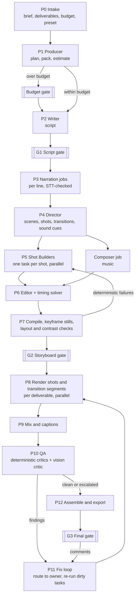
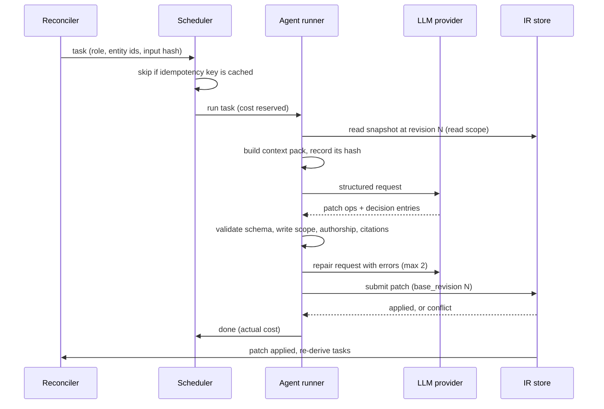

# Cinewright v0.1 — Implementation Plan

v0.1 ("Foundation") proves the core loop end to end: **brief → script → scenes/shots in the IR → HyperFrames renders → narrated, mixed, captioned MP4 → deterministic critics + vision critique with fix loop**, for explainers and short ads.

Scope comes from the decision log in `DESIGN_SPEC.md`, including D25–D41 from the implementation-readiness review (approved 2026-11-13). This plan, its M1 conventions and the resolved open issues were approved on 2026-11-13. If anything here conflicts with the spec or `AGENTS.md`, stop and raise it.

## Scope

**In:** explainer and short ad, 15–60 s, 16:9 and 9:16 (one or both per project, D28), a single narrator (D7) · Guided autonomy with gates at script, storyboard (shot list plus keyframe stills of the real compositions) and final (D8, D38) · HyperFrames backend and compositor (D10) · neutral default pack plus one contrasting pack (D39) · transitions: cut, cross-dissolve and one mask/wipe, rendered as segments (D34) · narration, one music provider plus a local library, mixer, sidecar and burned-in captions (D35, D38) · deterministic critics, Claude vision critique and the fix loop · the orchestration engine and v0.1 agent subset (§Multi-agent orchestration) · CLI · neutral benchmark v0, tiers A and B (D36).

**Out (later milestones):** Blender backend (v0.3) · multi-voice dialogue, cast bible beyond one narrator (v0.2) · music generation beyond one provider + library (v0.2) · generative video, lip sync, render-guided generation (v0.4) · Studio UI (v0.3) · OTIO/FCPXML, SDK, MCP server (v0.5) · Remotion plugin (optional, any time after v0.1) · proxy workflow (never, D23) · Composer agent (v0.2; a rules-based job fills the role in v0.1) · Style Designer agent and pack derivation (v0.3) · image-based storyboard frames and the animatic gate (v0.3) · untrusted third-party plugins and sandboxing (v0.5) · the flashing check, WCAG 2.3.1 (with the accessibility critic; the v0.1 components have no strobing preset).

## Exit gate

- The v0.1-alpha gate (after M5 and M6.1) has passed.
- Every v0.1 tier B benchmark brief (§M8) renders end to end with no manual edits in the Auto preset, in each of 3 runs.
- 100% of tier A and tier B renders pass the deterministic checks (§M6.1).
- Rendering the same resolved IR twice in the pinned container gives identical `framemd5` and PCM hashes for every shot, and byte-identical shot files on the same runner class (D33).
- Vision rubric scores are reported per brief with run-to-run variance, against a pinned critic model, as the baseline for later non-regression (D36).
- A Guided run pauses at all three gates, resumes after approval, and survives a process kill in every phase.
- The same briefs pass under both v0.1 packs, and switching packs needs no code or prompt change (D39).
- `cinewright` CLI runs a brief from init to export on a clean machine using only the documented setup, including a local-only run (Kokoro, library music, no stock).

**Status (2026-11-22):** checked once after M8.5 and not yet passed. Every milestone task through M8.5 has merged; what remains needs maintainer decisions (9, 13, 15) and the tier B release spend. Item by item: `docs/plans/m8-cli-benchmark.md` §Result.

## Milestones

Each task lists its acceptance criteria (AC). Milestones are ordered by dependency, with two exceptions: M6.2–M6.3 need M7.3–M7.5, and the alpha gate needs only M0–M5 and M6.1 (see §Suggested order). Tasks inside a milestone can run in parallel unless the milestone gives an order; M0 and M1 do.

One task is one PR. Tasks split for size carry a letter (M1.1a). Task ids are stable: do not renumber. Where a milestone has one shared AC list (M2, M3, M5, M7, M8), split it into per-task AC in that milestone's planning step, before its first PR.

Items that need a maintainer decision are collected in §Open issues.

### M0 — Repo and toolchain

Order: M0.0 → M0.1 → M0.2 and M0.3 in either order. Whichever lands second adds the render smoke job. Detailed task plan (approved 2026-11-13): `docs/plans/m0-repo-and-toolchain.md`, which runs M0.1 → M0.3 → M0.2. **Done 2026-11-14** (PRs #1, #4, #7, #8, #9); the render image digest is locked in `container/image.lock.json`.

- **M0.0 Prerequisites** (maintainer actions, no PR). Decided 2026-11-13: the repository is hosted on GitHub, CI runs on GitHub Actions, and the CPU render image is published to GHCR. The repository `jeremycai99/cinewright` was created on 2026-11-13 as a **private** repository on GitHub Free, so the GHCR image is private too. GitHub Free does not offer rulesets or branch protection on private repositories; until the repository is public or on a paid plan, M0.3's required checks are a written rule (merge only on green), not an enforced one. Packages use a provisional `@cinewright/*` npm scope until the name is confirmed; nothing is published in v0.1, so a rename stays mechanical. GPU CI is not needed before v0.3.
- **M0.1 Monorepo scaffold.** pnpm workspaces for TS packages, a uv workspace for Python packages, shared lint/format/test config, Apache-2.0 LICENSE, AGENTS.md, CLAUDE.md, CONTRIBUTING.md. Directories follow AGENTS.md §7, plus a `cli/` package (add it to AGENTS.md §7 and the spec's layout in this PR). The M0 plan names every TS and Python package, including where the generated Python types and the Python plugin SDK live. Create only the packages M1 needs; the rest arrive with their milestones.
  - Pins: Node (exact, `.node-version` and `engines`), pnpm (exact, `packageManager`), Python (`.python-version`), uv (`required-version`), and everything else through committed lockfiles (`pnpm-lock.yaml`, `uv.lock`) installed frozen. Every pin lives in a tracked file that CI and the Dockerfile read; none is floating or copied by hand. The Blender backend (v0.3) must use the Python its bpy release requires, so no package may assume one Python for the whole repo.
  - AC: on a clean checkout, `pnpm install --frozen-lockfile && pnpm test` and `uv sync --locked && uv run pytest` pass locally and in CI, each with one placeholder test (pytest fails when it collects none); lint and format checks run for both languages; a stale lockfile fails CI; an import-boundary check fails on `bpy` outside `plugins/backend-blender` and on any import of `fixtures/personal/` from a core package (AGENTS.md §2.3, §3 invariant 10).
- **M0.2 Render container.** One Linux image, built by CI from a Dockerfile in the repo and pushed to the registry; its digest is recorded in a tracked file and is the `container digest` in render keys (M1.5). Renders run with the network disabled (D33).
  - Pins, all exact: base image (by digest), Node, FFmpeg (version and build source with checksum), chrome-headless-shell (build id), HyperFrames (exact version; it is pre-1.0, so no ranges), the animation runtime (vendored in the image, never loaded from a CDN), font packages (no host font lookup), Python for analysis tools.
  - HyperFrames runs in its local mode inside this image. Do not use its own `--docker` flag: that builds a separate image we do not pin and would need Docker inside Docker.
  - The image has one entry point: a render job (composition directory in; frames or video, logs and hashes out) that the host starts with the network disabled. The M0 plan says whether the engine and CLI also run inside the image or only start it.
  - Render settings are set explicitly, never left on auto: worker count, capture path (BeginFrame through chrome-headless-shell), frame format, encoder settings and thread count, best-effort off (so a missing resource fails), low-memory mode fixed, preview discovery off, telemetry off (D21).
  - Runner class = CPU architecture + image digest + these settings. CI and tier A baselines use linux/amd64. The M0 plan says how the image runs on arm64 hosts (a native arm64 image is a second runner class with its own digest; chrome-headless-shell is published for linux64 only).
  - Spike, recorded in the PR: whether HyperFrames' own encode can meet D33 and M5.1 (same encoder settings, closed GOPs, bitexact muxing), or whether the backend should render a PNG sequence and encode with the pinned FFmpeg. M3.2 and M5.1 follow the result.
  - AC: CI builds and pushes the image, and the recorded digest matches the pushed one; a script prints every pinned version from inside the image and CI compares it with the pins; the HyperFrames hello-world (a paused timeline registered for seeking) renders in two separate container runs with identical `framemd5` and byte-identical files, and again on a second machine of the same runner class; a composition that references a remote URL fails the render with a non-zero exit and an error that names the URL. If byte-identity cannot be met, stop and raise it (D33 is binding); do not weaken the check.
- **M0.3 CI.** Lint, format, unit tests and lockfile checks on every PR. The container render smoke test runs on main and on any PR that touches the Dockerfile, the pins or backend code. PRs from forks run every required check without secrets. Schema checks are added by M1.1a (schemas valid) and M1.6 (generated types in sync).
  - AC: a PR with a failing unit test, a lint error or a stale lockfile turns a required check red (shown with throwaway PRs). The required checks are listed in `.github/rulesets/main.json`; once the ruleset is applied, such a PR cannot merge. A PR from a fork runs the same required checks with no secrets available (checked statically by `cinewright-check-workflows`).
  - Decided 2026-11-13: the repository stays private on GitHub Free for now, which offers no rulesets on private repositories. The ruleset is applied when the repository goes public or moves to a paid plan; until then, merging only on green is a written rule, not an enforced one.

### M1 — IR v0 (the contract everything else depends on)

Implements D25–D32 and D40. Detailed task plan (approved 2026-11-14): `docs/plans/m1-ir-v0.md`. M1 also creates the `cinewright` CLI package with `init`, `patch` and `show`; M8.1 adds the other commands. **Done 2026-11-15** (PRs #10–#25).

**Order.** M1.1a → M1.6 → M1.1b → M1.1c → M1.7 → M1.4a → M1.4b → M1.2a → M1.2b → M1.9. M1.6 lands straight after M1.1a so the wrapper encoding is proven on both code generators before more schema is written. M1.3 can start after M1.1c; M1.5 needs M1.3 and M1.7. M1.8a and M1.8b need only M0.

#### M1 conventions

Items 1–4 restate decisions. Items 5–16 settle what the decisions left open and were approved with this plan on 2026-11-13. Each names the task it first affects.

1. **Two JSON forms (D30, D40).** The *stored form* is what the store writes to disk: sorted keys, pretty-printed, one trailing newline. The *hash form* is RFC 8785 (JCS): the same key order, no whitespace. Every hash of IR data is SHA-256 over the hash form; an asset's hash is SHA-256 over its bytes. In this plan "canonical JSON" means the stored form.
2. **Time (D27).** Stored times are integer frames; audio offsets are integer samples. Patch inputs may use seconds or timecode, and the store normalizes them. Input forms: an integer is frames; `"18s"`, `"1500ms"` or a timecode string converts to the nearest frame.
3. **Ops (D30).** `set`, `unset`, `insert`, `remove`, `move`, `lock`, `unlock`, `suggest`, each addressing an entity id plus a JSON Pointer.
4. **No hand edits (D25, D40).** This covers projects. The schema test fixtures in M1.1 are test data and are written directly: the store does not exist yet, and an invalid fixture cannot come from it. From M1.9 on, valid project fixtures are built through the store.
5. **Schema dialect** (M1.1a). JSON Schema 2020-12, limited to what both code generators handle: no `if`/`then`/`else`, `prefixItems`, `dependent*` or `unevaluated*`; `oneOf` only with a `const` discriminator. Rules the schema cannot express go in the semantic validator (M1.1c).
6. **Wrapper** (M1.1a). `{ "value": T, "state": "open" | "agent" | "user" | "locked" }`. An `open` field has no `value` key. A wrapped value holds no nested wrappers; the one exception is an entity list (convention 7). The schema marks an authorable field with an annotation keyword, so the store, `show` and the generators can find it. A field is authorable if a person or agent could choose its value. Ids, entity kinds, store metadata and measured data (asset hashes, provenance, word timestamps) are plain. Each schema lists its authorable fields in a table in the same PR.
7. **Lists** (M1.1a, M1.2a). Three kinds. *Entity lists* (sequences, scenes, shots, layers, beats, lines, cast) are `{ "value": [entity, …], "state" }`; their state governs membership and order only, and items keep their own field states. The project's sequence list holds ids in order; each sequence body is its own file (D40). *Value lists* (`mood`) are ordinary wrapped values, replaced whole. *Maps* (voice bindings, per-aspect layouts, style overrides) have one wrapper per entry.
8. **Lock targets** (M1.2a; see Open issue 1). `lock` on a field freezes that value. `lock` on an entity list freezes membership and order. `lock` on an entity (empty path) freezes the whole subtree. Gates lock the fields and lists they name, never whole entities, except G3. Derived entities (takes, timing anchors, captions) reference a line by id and are never children of it, so a locked line can still receive takes.
9. **Ids** (M1.1a). Match `^[a-z][a-z0-9_]*(\.[a-z0-9_]+)*$`, at most 64 characters, unique across all entity kinds in a project, supplied by the author of the `insert`, immutable, and never reused after removal. Ids carry no position: `move` never renames. Each sequence is stored as `sequences/<id>.json`.
10. **Patch wire format** (M1.4a). Patches carry bare values. The store adds wrappers and sets `state` from the author: `agent` for agents and jobs, `user` for the user and for approved or dictated session edits. Only `lock` and `unlock` change state directly, and only a user or a gate may send them. `path` points at an authorable field or an entity list, never inside a wrapped value.

    ```json
    {
      "base_revision": 12,
      "author": { "kind": "agent", "role": "shot_builder" },
      "mode": "apply",
      "reason": "Title overflows in portrait",
      "ops": [
        { "op": "set", "entity": "s03.sh01", "path": "/framing", "value": "full_frame" },
        { "op": "insert", "entity": "s03_the_problem", "path": "/shots", "after": "s03.sh01",
          "value": { "id": "s03.sh02", "type": "motion_graphics" } }
      ],
      "decisions": [{ "ops": [0, 1], "choice": "…", "citations": ["finding:f_0042"] }]
    }
    ```

    Author kinds: `user`, `agent` (with a role), `job` (with a name), `session` (an agent acting directly for the user). `mode` is `apply` or `propose`. In v0.1 the caller asserts its author kind, and every log entry records the session id (D41).
11. **Revisions** (M1.4a). `revision` is an integer that grows by one per applied patch. `state_hash` is the SHA-256 of the hash form of the whole IR (project file with sequence files inlined, store metadata excluded). A revert is a new patch with a new revision whose `state_hash` equals the target's. Two patches conflict when a patch applied after `base_revision` touched the same field or list, or removed or locked an ancestor. The store takes an exclusive file lock per patch, so writers in separate processes are serialized.
12. **Patch log and decision log** (M1.4a, M1.7). They are production state (D37), so they live outside `.cinewright/runs/` and `.cinewright/cas/` and are tracked in git: `log/patches.jsonl` and `log/decisions.jsonl`, append-only, one JSON object per line. Each applied entry records its revision and resulting `state_hash`. Pending patches (proposals, suggestions) and their approval or rejection are entries too, and so is a failed approval, which leaves the patch pending. On load the store recomputes `state_hash` and compares it with the last applied entry; on a mismatch it replays the log to name the changed entity and field.
13. **Authorship-blocked ops** (M1.2a). A patch is all or nothing. If any op is blocked by authorship, nothing is applied and the whole patch is stored as a pending suggestion; the author may resubmit without the blocked ops. A `user` item (D25) is an entity inserted by a user patch or holding any `user` or `locked` field.
14. **Readable view** (M1.9). `cinewright show <id>` prints YAML-like text as in the spec's examples. It is output only and is never parsed. It shows the entity id and kind, every field with its state as a trailing comment, times in seconds (`--frames` for frames), script lines inline in scenes, pending suggestions next to their field, and child entities one level deep (`--depth`). `--resolved` adds cascade-resolved values with origins (after M1.3). `--json` prints the stored form.
15. **Timing anchors** (M1.1c). An anchor is a line id plus `start`, `end` or a word index, plus a frame offset. A text edit that removes an anchored word raises a finding for the owning shot's builder.
16. **Delivery profile pinning** (M1.1a, M1.7). The project records each deliverable's profile id and content hash and stores a copy of the profile body, so stored frame values keep their meaning if the profile file changes.

#### Tasks

- **M1.1 JSON Schema** for Project, Script (beats and lines with stable ids, D26), Sequence, Scene, Shot, Layer, Cast (narrator only in v0.1, schema ready for more; voice = neutral description plus provider bindings, D29), Style reference, Asset, DeliveryProfile (frame rate, sample rate, aspect, safe zones, loudness and true-peak targets, caption rules) and Deliverable (D4, D28). Every entity has a project-unique `id`; every authorable field is a `{ value, state }` wrapper, and the schema marks which fields are authorable (D25). Stored times are integer frames at the project rate (D27). Three PRs:
  - **M1.1a Common definitions and project.** Ids, the wrapper, list and map shapes, time, references, `schema_version`; Project, Deliverable, DeliveryProfile; the TS validator harness for 2020-12 and the fixture layout. Python reads the IR through the generated models (M1.6).
    - AC: valid and invalid fixtures for each schema; each invalid fixture has an expected error list (entity id, JSON Pointer, rule code) that the test matches exactly; every schema validates against the 2020-12 meta-schema in CI.
  - **M1.1b Script and Cast.** Beats and lines (text, direction, speaker, on-screen text); cast members with voice description, lexicon and bindings.
    - AC: as M1.1a for these schemas; the stored form of the spec's cast example validates.
  - **M1.1c Sequence, Scene, Shot, Layer, Style reference, Asset, and the semantic validator.** The Layer schema carries what D31 requires: component id, props, token references, motion presets and anchor-relative timing, per aspect class. Timing anchors follow convention 15. The semantic validator checks what JSON Schema cannot: unique ids, every reference resolves (line, cast, asset, deliverable, style), one frame rate across deliverables (D27), no id reuse.
    - AC: the stored form of the spec's scene example validates, including its out-of-scope shot types (the v0.1 capability check is P0 intake, M7.1, and is not tested here); a fixture with a dangling reference, a duplicate id or two frame rates fails with the expected error list.
- **M1.2 Authorship enforcement** (D25). Two PRs:
  - **M1.2a State rules.** Field states from wrappers, the lock targets in convention 8, list rules, and the transition table: who may move a field from which state to which (agents and jobs: `open`→`agent`, `agent`→`agent`, and `unset` from `agent` to `open`; user: any→`user`, `lock`, `unlock`, and `unset` back to `open`; gates: →`locked`).
    - AC: property tests, at least 1,000 generated cases per property with the seed printed on failure, over generated IR instances and generated agent patches. They prove that no agent or job patch changes the value or state of a `user` or `locked` field, anything under a locked entity, the membership or order of a `user` or `locked` list, or removes a `user` item; and that every transition outside the table is rejected.
  - **M1.2b Pending patches.** Suggestions stored as pending patches instead of writes; propose-first for conversational edits (pending patch → approve or reject; approved fields become `user`); the project setting that turns propose-first off (D25).
    - AC: every authorship-rejected agent patch appears as a pending suggestion in the patch log; a `session` patch in `propose` mode changes no file until approved; approving it sets the touched fields to `user` and records the approver; approving a pending patch whose base has since changed fails with a conflict; rejecting records the rejection and changes nothing.
- **M1.3 Cascade resolver** Project → Sequence → Scene → Shot → Layer for style tokens and inherited values, with the origin of each resolved value; per-aspect layout variants resolve per deliverable. Pack tokens are an input here (a plain JSON token tree); the pack format is M2.1.
  - AC: for nested override fixtures and for each deliverable, the resolved value and origin (level and entity id, or pack) of every token match a checked-in expected file; a token reference that does not resolve is an error naming the entity and field.
- **M1.4 IR store and patch engine** (D30). Two PRs:
  - **M1.4a Ops, revisions and the patch log.** The wire format, all eight ops with their inverses, atomic apply, revisions and `state_hash`, the append-only patch log with author, reason and decision entries, and detection of edits made outside the store (conventions 10–12).
    - AC: for every op, apply then revert gives the starting `state_hash` under a new revision; a patch with one invalid op changes nothing; killing the process at any point during an apply leaves either the old or the new revision on disk, never a mix; a hand-edited file fails to load with an error naming the file and the changed entity; replaying the patch log from an empty project reproduces the current `state_hash`.
  - **M1.4b Concurrency and write scopes.** Field-level optimistic concurrency via `base_revision`; role write scopes as data (a role maps to allowed entity kinds and field paths). M1 ships the mechanism and a test scope; the v0.1 role table (§Roles) is encoded in M7.4.
    - AC: two patches from separate processes on disjoint fields both apply; of two that overlap, the later is rejected with a conflict that lists the fields and the revision that changed them, and writes nothing; a patch outside its role's write scope is rejected and names the op.
- **M1.5 Dependency graph and render keys.** Render key per shot × deliverable = hash(resolved shot spec, referenced asset hashes, component versions, backend plugin version, container digest). Dependency edges: script line → take → timing anchors → shot durations → renders and adjacent transition segments → mix → captions → assembly. Versions and the digest are inputs here (opaque strings); real values arrive with M2–M3.
  - AC: on a fixture, changing one shot dirties only that shot's renders, its adjacent transition segments and the assembly; changing a project-level token dirties every shot whose resolved spec uses it and no script, take or planning node; the same inputs give the same render key on every run, whatever the key order of the input.
- **M1.6 Generated types** for TS and Python from the schemas. Tools: `json-schema-to-typescript` and `datamodel-code-generator`, pinned exactly (§External facts). Lands after M1.1a and re-runs as schemas are added.
  - AC: types regenerate in CI and drift fails the build; the TS output compiles under strict mode and the Python output passes the type checker; every valid M1.1 fixture parses into the generated types in both languages and serializes back to JSON equal to the input.
- **M1.7 Project layout, canonical writer and CAS**: on-disk format (D40), canonical JSON written only by the store: `cinewright.json` plus one file per sequence under `sequences/`; the stored-form writer and hash-form hasher (convention 1), in TS only: in v0.1 Python packages read the IR but never write or hash it; `.cinewright/cas/` content-addressed store (atomic put, hash verified on get), `.cinewright/runs/` reserved for run ledgers and event logs (their format is M7.1), and a `.gitignore` template that excludes both. `cinewright init` requires at least one deliverable, because the frame rate comes from its delivery profile (D27); M1 ships two fixture profiles as test data, and the real ones are M5.3. Changing the frame rate of a project that already holds timed entities is rejected in v0.1.
  - AC: `init` creates a project that validates; load → save produces byte-identical files (D40); the hasher reproduces the RFC 8785 test vectors and a checked-in vector file covering floats, non-ASCII keys and escapes; assets referenced by hash resolve from the CAS, a corrupted CAS file fails with an error naming the hash, and a missing asset names the referencing entity; deleting `.cinewright/runs/` changes neither `show` output nor `state_hash`.
- **M1.8 Plugin contract v0** (D32). The contract here is the generic envelope: manifest, lifecycle, request/response, errors, cancellation. Kind-specific interfaces land with their milestones (backend M3.2, TTS M4.1, music M4.3, STT M4.5, critics M6, LLM M7.3). Two PRs:
  - **M1.8a Manifest, loader and in-process interface.** Manifest JSON Schema (kind, capabilities, cost model, latency class, output license terms, required secrets, runtime, concurrency and rate limits), loader, in-process TS interface, conformance-kit skeleton.
    - AC: a stub plugin passes the kit in process; the kit checks that the manifest validates, that declared capabilities match what the plugin reports, that a golden request returns the expected result, that a failing request returns a typed error, and that cancellation stops the call; a manifest without output license terms is rejected.
  - **M1.8b Subprocess host.** JSON-RPC 2.0 over stdio, process lifecycle (start, health check, timeout, shutdown), and a minimal Python plugin SDK.
    - AC: the same stub, written in Python, passes the same kit as a subprocess; a plugin that hangs is killed at the timeout and reported as a typed error; no child process survives the host's exit.
- **M1.9 Patch and show commands**: `cinewright patch` (`propose`, `approve` for a pending patch, `apply` for authors that need no approval, `reject`, `list --pending`, `revert`; JSON ops in, readable diff out) and `cinewright show` (convention 14). Both have `--json` output and documented exit codes, because agents call them. This is how Claude Code and other agents edit a project, so it lands with M1 rather than with the rest of the CLI.
  - AC: a checked-in script builds the M1 reference project (the spec's scene and cast examples, with a script, one sequence and two deliverables) using only `init`, `patch` and `show`, and the result is byte-identical to the checked-in fixture; `show` output for that project matches golden files, including each field's state; the readable diff of each patch matches a golden file; every applied patch appears in the patch log with its author and approval. One recorded trial of a coding agent building the same project from a prose description is attached to the PR.

### M2 — Style system v0

Detailed task plan (approved 2026-11-15): `docs/plans/m2-style-v0.md`. It splits the shared AC per task and resolves Open issue 6. **Done 2026-11-16** (PRs #26–#34).

- **M2.1 Style pack format** (tokens JSON + rules Markdown + example frames) and loader. Every rule has a stable id, which agents cite in decision-log entries.
- **M2.2 Neutral default pack**: deliberately restrained and legible (see AGENTS.md §2.2). Define grid, safe areas and layout templates per aspect class, type scale, motion grammar (easing set, duration scale, entrances/exits), transition set and when each applies, density limits, sound palette and ducking depth. Loudness targets come from delivery profiles, not the pack.
- **M2.3 Contrasting pack** (D39): one pack from D14 deliberately opposite to the default (playful/kids), differing in type, palette, motion grammar, transitions and sound palette.
- **M2.4 Component library v0** (HyperFrames/GSAP; settle Open issue 6 on the GSAP licence before this task). Each component ships a props JSON Schema and a catalog description, because agents choose components from that catalog (D31). Alpha set: kinetic title, bullet reveal, end card, caption track. Beta set: lower third, bar/line chart, quote card, image/video plate with Ken Burns. Components read tokens only; no literal colors, fonts or easings.
  - AC (M2 overall): a lint rule fails any component containing literal design values; every component renders correctly in both aspect ratios and both packs; the same IR renders under either pack by changing only the style reference.

### M2.5 — Audit fixes

The implementation audit of 2026-11-16 (`docs/plans/roadmap-audit-2026-11-16.md`) found M0–M2 sound, with one data-loss bug and four places where the code enforces less than the docs claim. These land before M3.

- **M2.5a Store revert** (audit F1): a list op snapshots the list's order and the bodies of removed items only, so reverting it never discards later edits to other items; a revert after a later change to the same list conflicts.
  - AC: for each list op, a revert after a later edit to a sibling keeps that edit; a revert after a later change to the same list conflicts; replay still reproduces every `state_hash`, including old logs.
- **M2.5b Markers enforced** (F2, F7): `render-job check` reads `data-cw-overflow` and `data-cw-density` at each sample and reports them as failures; `cinewright-check-specimens` fails on a root with no specimens.
  - AC: a 7-bullet example under a limit of 5 fails, naming the element; an empty root exits non-zero.
- **M2.5c Hermetic tests** (F6, F20): a shared Vitest timeout; tests that list folders ignore untracked names; the specimens job also triggers on the cascade.
  - AC: the suite passes with stray untracked files present, 10 runs in a row.
- **M2.5d Plan and docs** (F8, F15): this plan revision; status lines; `patch revert` named alongside `patch approve` in D41.

### M3 — HyperFrames backend

Detailed task plan (approved 2026-11-16): `docs/plans/m3-hyperframes-backend.md`. **Done 2026-11-16** (PRs #40–#49).

- **M3.1 Shot compiler**: resolved shot IR (typed layers) + pack → HyperFrames composition (HTML, the component host bundle and a mount spec; components animate with WAAPI, which HyperFrames seeks, per Open issue 6), once per deliverable. The compiler is the only producer of HTML (D31).
- **M3.2 Renderer adapter**: render per shot × deliverable inside the container with the network disabled; collect logs, timings, `framemd5` and output hash; cache by render key.
- **M3.3 Transition segments** (D34): render cross-dissolve and mask/wipe segments from the tail of the outgoing and the head of the incoming composition; hard cuts need no segment.
- **M3.4 Caption layer** (D35): when a deliverable's profile requires burn-in, compile captions from line timestamps into each shot; a cue spanning a cut is split and drawn identically on both sides.
- **M3.5 Keyframe capture**: still frames at the densest moments for critics and the storyboard gate (DOM snapshot and image).
  - AC: the spec's scene example (motion-graphics shot) compiles and renders in both aspect ratios; the determinism test passes; a revised shot re-renders only itself and its adjacent transition segments; the HyperFrames API in use is checked against current upstream docs and pinned (§External facts lists what was checked on 2026-11-13); encoding follows the M0.2 spike.

### M4 — Audio

Detailed task plan (approved 2026-11-17): `docs/plans/m4-audio.md`, revised after the audit `docs/plans/audit-m3-m4-plan-2026-11-16.md`. It starts with **M3.6**, the audit's M3 fixes (body ranges, render key, caption overlap, container tests in CI), and moves M4.3b (generative music) after the alpha gate.

- **M4.1 TTS provider interface** + ElevenLabs plugin (with character/word timestamps) + Kokoro local plugin (a Python subprocess plugin, M1.8b; word timestamps come from M4.5 alignment where the provider returns none). The voice comes from the narrator's provider binding (D29); plugins translate the pronunciation lexicon. Takes are frozen in the CAS with provenance (D33).
  - AC: the same narration renders through either plugin and yields timing anchors in the IR; re-running the pipeline reuses frozen takes.
- **M4.2 Timing solver**: narration timestamps become the master clock, mapped to frames; shot durations snap to them within the scene's `flex`. An overrun beyond `flex` produces a finding for the Editor (then the Writer) instead of silently stretching.
- **M4.3 Music and SFX interface** + one generative provider plugin + local library fallback. In v0.1 the Composer role is a rules-based job that builds the request from the pack's sound palette and the sequence mood. Every asset records provider, plan tier and license.
- **M4.4 Mixer**: dialogue/music/SFX buses, ducking from pack rules, loudness normalization and true-peak limit from the delivery profile.
  - AC: mixed output meets the profile's loudness and true-peak targets; music ducks under dialogue.
- **M4.5 STT and alignment interface** + one local plugin (WhisperX, D16). Used by M4.1 (word timestamps for TTS plugins that return none), the P3 narration check and the STT-vs-script critic (M6.1). Lands before M4.1's AC can pass. See Open issue 8.
  - AC: a frozen take yields a transcript and word timestamps; the same take gives the same result on every run in the pinned container, or the tier A check compares against a frozen transcript instead.

### M5 — Assembly and delivery

Detailed task plan (approved 2026-11-20): `docs/plans/m5-assembly-delivery.md`.

- **M5.1 Assembly**: concatenate shot bodies and transition segments (same encoder settings, closed GOPs, concat demuxer, no re-encode, bitexact muxing), mux audio.
- **M5.2 Captions**: SRT/VTT sidecars from line timestamps, always; burn-in comes from M3.4.
- **M5.3 Delivery profiles v0**: two data-file profiles, e.g. "landscape web" and "vertical social" (frame rate, sample rate, safe zones, max duration, codec/bitrate, loudness and true-peak targets, caption rules).
- **M5.4 Render command (walking skeleton)**: `cinewright render` runs the non-agent jobs for a complete IR in dependency order (M1.5): narration, timing solve, compile, render, transition segments, mix, captions, assembly. M6.1 adds the deterministic critics to it. No scheduler, gates or agents; M7 later drives the same jobs. The alpha gate needs this command, so it cannot wait for M8.1.
  - AC: a one-shot revision re-renders only that shot and its adjacent transition segments, and re-assembles without re-encoding the others.

### M6 — Critics and fix loop

Detailed task plan for M6.1 (approved 2026-11-20): `docs/plans/m6-1-deterministic-critics.md`.

Detailed task plan for M6.2–M6.3 (approved 2026-11-20): `docs/plans/m6-2-3-vision-fix-loop.md`.

M6.1 belongs to the alpha gate. M6.2 and M6.3 need the LLM provider, agent runner and agents (M7.3–M7.5) and land after them.

- **M6.1 Deterministic critics**: DOM text overflow/collision/safe-area, contrast floors, minimum text size and hold time, loudness/true-peak, silence gaps, clipping, black/frozen frames, STT-vs-script diff, ffprobe spec, license presence. Every finding carries type, severity, entity path, frame range, evidence and a signature (§Multi-agent orchestration).
- **M6.2 Vision rubric critic**: Claude on keyframes and transition frame strips; grades against brief + resolved pack + craft rules (never a house aesthetic). Rubric and prompt are versioned, the critic model is pinned per baseline (D36), and each finding names a shot or scene.
  - AC: run-to-run score variance on tier A fixtures is measured and recorded; each v0.1 pack's mean rubric score on its tier A fixtures meets a threshold recorded in the baseline.
- **M6.3 Fix loop**, as specified in §Multi-agent orchestration: routing table, deterministic fixers before agents, per-finding, per-shot and per-run bounds, oscillation detection, fix budget reserve, escalation to a gate.
  - AC: seeded defect fixtures (overflowing title, low contrast, clipped audio, missing caption, hold time too short) are each detected and routed to the right owner; the loop resolves at least the layout, contrast and loudness fixtures automatically; a seeded oscillating fix is stopped and escalated.

### v0.1-alpha gate — walking skeleton, no agents

Detailed task plan (approved 2026-11-20): `docs/plans/alpha-gate.md`.

Needs M0–M5 and M6.1. An IR fixture written through `cinewright patch` (one explainer, both aspect ratios, both packs) goes through `cinewright render` to a narrated, mixed, captioned MP4 that passes every deterministic check, and a one-shot edit re-renders only that shot. These fixtures become the first tier A benchmark entries. Agent work (M7) starts after this gate.

### M7 — Engine and agents

Detailed task plan (approved 2026-11-20): `docs/plans/m7-engine-agents.md`.

Implements §Multi-agent orchestration (D5, D9, D37).

- **M7.1 Runtime interface** with a LangGraph implementation: workflow templates as data (explainer, ad), the IR reconciler that derives tasks from IR state, P0 intake checks (budget set, the v0.1 capability check), the run ledger and event log (their formats are defined here, as JSON Schema), gate pauses. LangGraph checkpoints are a cache. A LangGraph interrupt needs a checkpointer and restarts its node from the top on resume, so gate nodes must be idempotent.
- **M7.2 Scheduler**: idempotency keys, per-provider concurrency and rate limits from manifests, retries with backoff, routing fallback, CPU render pool.
- **M7.3 Provider interface for LLMs** with the Claude reference implementation (D9): structured output; frontier tier for Producer, Writer, Director, Editor and the vision critic, mid tier for Shot Builders (configuration, not code); recorded-response cassettes keyed by context-pack hash.
- **M7.4 Agent runner**: context-pack builder from read scopes, output validation (schema, write scope, authorship, citations), repair loop, conflict retry, decision-log entries.
- **M7.5 Agents (v0.1 subset)**: Producer, Writer, Director/Scene Planner, Shot Builder (typed layers, never HTML), Editor, vision critic. Prompts state craft principles only.
- **M7.6 Gates and autonomy presets**: Auto, Guided, Directed, Manual; gate packets; approve, edit, request variants, reject with notes; human-filled roles through the task queue.
- **M7.7 Cost ledger and budget cap** (D17): estimate before production, reservation per paid task, fix reserve, pause at cap, re-estimate at every gate. Actual spend is recorded outside `.cinewright/runs/`, which is disposable (M1.7), so deleting run state cannot reset the cap.
  - AC: with stub agents, a run reaches each gate, resumes after approval and survives a process kill in every phase; with real agents, a brief runs autonomously to the first gate; replaying cassettes reproduces the same IR `state_hash` (M1 convention 11); setting any agent role to `human` runs the same workflow through the task queue; a run that would exceed its budget pauses before spending past the cap.

### M8 — CLI and benchmark v0

Detailed task plan (approved 2026-11-20): `docs/plans/m8-cli-benchmark.md`.

- **M8.1 CLI**: `cinewright init | patch | show | plan | render | review | export | status | tasks | log` (`init`, `patch` and `show` from M1; a first `render` from M5.4), non-interactive flags and JSON output for CI.
- **M8.2 Benchmark v0** in `fixtures/benchmark/` (D36). Tier A: frozen IR and assets, starting from the alpha-gate fixtures and growing with snapshots of good tier B runs. Tier B: at least 8 neutral briefs covering explainer and ad × 15/30/60 s × 16:9/9:16, with at least 2 briefs requesting both aspect ratios, spanning different subjects and tones and split across both packs. No personal briefs. This is the v0.1 subset; the suite grows to the full coverage in AGENTS.md §4.1 by v1.0.
- **M8.3 Eval harness**: tier A on every PR (no paid APIs, safe for forks); tier B nightly and on maintainer trigger, 3 runs per brief, budget-capped. Reports per-brief deterministic pass rate, rubric mean and variance, cost and latency, stored per commit with the critic model and rubric version.
- **M8.4 Personal fixtures**: `fixtures/personal/` for the maintainer's dogfooding briefs; never imported by core, never gating.
  - AC: the exit gate above passes.

## Revised task breakdown and order (audit, 2026-11-16)

Overview from 2026-11-20 to the v0.1 exit and on to v1.0 (approved 2026-11-20): `docs/plans/completion-roadmap.md`.

The 2026-11-16 audit (`docs/plans/roadmap-audit-2026-11-16.md`, §4) refined the milestones above into PR-sized tasks, added tasks for gaps it found, and moved some work earlier. Where it differs from a milestone's text above, this section wins; each milestone still gets its own detailed plan and approval before its first PR. New tasks are marked *new*.

| Milestone | Tasks (in order) | Changes from the text above |
| --- | --- | --- |
| M2.5 *new* | M2.5a store revert · M2.5b markers enforced · M2.5c hermetic tests · M2.5d plan and docs | Audit fixes, before M3 |
| M3 | **M3.0** *new* pin refresh (HyperFrames, Chrome; rebuild and lock the image; re-verify readiness, `data-no-timeline` and PNG output) · **M5.3** moved here (delivery profiles in `registry/`; `init` by profile name) · **M3.1a** compile inputs (pack resolved by id and pinned in the project; a timing table, line id → frames, from a fixture until M4.2; compile-time prop checks) · **M3.1b** shot compiler (goldens; both packs by changing only `style.pack`; hostile pack strings cannot add markup; deterministic output) · **M3.2a** backend interface and renderer adapter (run limits on Docker; a video plate's frames change over time) · **M3.2b** render key v1 and cache (key on the compiled composition's inputs, not `Pack.hash`) · **M3.3** transition segments (the timing rule is settled in the M3 plan) · **M3.4** caption layer · **M3.5** keyframe capture | M5.3 moves forward; M3.1 and M3.2 split; the render key is redefined (F3); pack resolution and pinning (F4); escaping (F5); Docker limits (F17) |
| M4 | **M4.0** *new* audio spike and a second pinned `audio` image (mixer repeatability, Kokoro and WhisperX on CPU, models baked in, the PCM contract written into D33) · **M4.5a** STT/alignment interface, transcripts frozen as assets · **M4.5b** WhisperX plugin (digits get interpolated times) · **M4.1a** TTS interface, takes, narration job · **M4.1b** ElevenLabs (word times derived from character times) · **M4.1c** Kokoro (its own Python, below 3.13) · **M4.2** timing solver · **M4.3a** music/SFX interface, library, Composer job · **M4.3b** one music plugin · **M4.4** mixer | Spike first; M4.1, M4.3 and M4.5 split; alignment against the script for timing, transcription only for the STT check |
| M5 | **M5.1** assembly · **M5.2** sidecar captions · **M5.4** `cinewright render` | M5.3 moved to M3 |
| M6.1 | **M6.1a** critic interface, finding schema, DOM critics (wrapping `render-job check`) · **M6.1b** media critics · **M6.1c** STT-vs-script critic on frozen transcripts | Split |
| Alpha gate | **A.1** *new* CAS remote (Open issue 7) · **A.2** *new* alpha fixtures (built only through `cinewright patch`; Kokoro takes; CC0 music) · **M8.3a** tier A harness as a required check | The tier A harness moves from M8 to the gate |
| M7 | **M7.1a** runtime interface, run ledger and event log, a plain loop runtime · **M7.1b** reconciler, templates, P0 intake · **M7.1c** LangGraph runtime and gate pauses · **M7.2** · **M7.3** (model-name boundary rule) · **M7.4** (per-task entity scopes, inserted-subtree checks) · **M7.5a** Producer and Writer · **M7.5b** Director · **M7.5c** Shot Builder and Editor · **M7.6** · **M7.7** · then **M6.2**, **M6.3a** fix routing and deterministic fixers, **M6.3b** bounds, oscillation, escalation | M7.1 and M7.5 split; a loop runtime before LangGraph (decide D5 at M7.1c) |
| M8 | **M8.1** · **M8.2** · **M8.3b** tier B harness · **M8.4** · **M8.5** *new* clean-machine setup tested in CI | M8.3 split |

**Order.** M2.5a–d → M3.0, M5.3 → M3.1a → M3.1b → M3.2a → M3.2b → M4.0 → M4.5a → M4.5b, M4.1a → M4.1c, M4.2 → M3.3, M3.4, M3.5, M4.1b, M4.3a, M4.3b, M4.4 → M5.1, M5.2 → M5.4 → M6.1a–c → A.1, A.2, M8.3a → **alpha gate** → M7.1a → M7.1b → M7.2, M7.3 → M7.4 → M7.1c, M7.6, M7.7 → M7.5a → M7.5b → M7.5c → M6.2 → M6.3a → M6.3b → M8.1, M8.2, M8.4 → M8.3b, M8.5 → **exit gate**. Tasks separated by commas can run in parallel.

**Exit gate clarifications.** "Byte-identical shot files" is checked per runner class, and the rubric baseline records the HyperFrames version with the critic model and rubric versions.

**Decisions the audit asks of the maintainer** (recommendations in the audit, §7): bump policy for HyperFrames (M3.0); keep GSAP in the image (M3.1b); pin the pack in the project (M3.1a); the transition timing rule (M3 plan); a second image for audio (M4.0); Kokoro's espeak-ng (GPL-3.0) behind a process boundary (M4.1c); going public or a public mirror for tier A on forks (alpha gate); who writes the benchmark briefs (M8.2); the evaluation budget and tier B cadence (M8.3b); LangGraph after M7.1a (M7.1c); splitting v0.3 and scheduling schema migrations in v0.2 (v0.1 exit); paid raters (v0.2); name, organisation and npm scope (v0.1 exit). Moving the checkout out of iCloud is due now: its duplicate files break local tests.

## Multi-agent orchestration (v0.1)

How the engine runs agents, jobs and humans for the explainer and ad workflows. It implements D25, D30, D31 and D37, and is what M6.3 and M7 build. Later milestones add roles and phases (Casting, Dialogue Director, Composer, Style Designer, Storyboard Artist, Finisher, Localizer); the mechanics below stay the same.

### Principles

1. **The IR drives the work.** The reconciler compares the IR against the workflow template and the dependency graph (M1.5) and emits a task for every required field that is `open` or whose inputs changed. A human edit, an agent patch and crash recovery all take the same path.
2. **Fixed workflow, bounded agents.** Control flow comes from a declarative workflow template (phases, gates, roles), not from an LLM deciding what runs next. Each agent makes creative decisions inside one task.
3. **Agents propose, solvers dispose.** Agents emit typed patches. Deterministic code (timing solver, compiler, mixer, critics) enforces constraints and produces media.
4. **Scoped reads and writes.** Each role has a read scope (what goes into its context pack) and a write scope (what its patches may touch). The IR store rejects writes outside scope.
5. **Cheap before expensive.** Text, then narration, then plans and stills, then full renders. Every gate shows the cost to continue.
6. **Idempotent tasks.** A task's key is the hash of its type, inputs and plugin version. Results are cached in the CAS, so a re-run after a crash or an edit pays only for what changed.

### Components

| Component | Responsibility |
| --- | --- |
| IR store | Single writer (D30): applies patches serially, enforces authorship and write scopes, keeps revisions, the patch log and the decision log |
| Reconciler | Derives the pending task set from the current revision, the workflow template and the dependency graph |
| Orchestrator | LangGraph graph per template: phase order, gate pauses, fix-loop bounds. Holds run state only (D37) |
| Scheduler | Runs tasks with idempotency keys, provider concurrency and rate limits, retries, routing fallback and a CPU render pool |
| Agent runner | Builds the context pack, calls the LLM provider, validates output, runs the repair loop, submits the patch |
| Job runner | Runs non-agent tasks: TTS, music, compile, render, mix, assemble, deterministic critics. Generation outputs are frozen in the CAS (D33) |
| Critic orchestrator | Engine code: dedupes findings, assigns owners, prefers deterministic fixers, enforces loop bounds |
| Gate manager | Builds gate packets, pauses the run, turns human decisions into patches |
| Cost ledger | Estimates, reserves and records cost per task; pauses at the cap (D17) |
| Event log | Append-only JSONL per run in `.cinewright/runs/<id>/`, read by the CLI (and Studio later) |

### Roles

Any agent role can be set to `human`. Its task then waits in the task queue (`cinewright tasks`), and the human's submission goes through the same validation, stamped `user`. Jobs are deterministic code, but their parameters are IR fields a human can edit.

| Role | Kind | Reads (context pack) | Writes (scope) | Tier |
| --- | --- | --- | --- | --- |
| Producer | Agent | Brief, deliverables, budget, workflow template, installed pack descriptions, provider cost models | Project plan, pack selection (unless the user set it), cost estimate | Frontier |
| Writer | Agent | Brief, plan, narrator profile, deliverable max duration, pack density limits | Script: beats, lines (text, direction), on-screen text | Frontier |
| Narration | Job | Script lines, narrator binding, lexicon | Takes (CAS assets), word timestamps, timing anchors | — |
| Director / Scene Planner | Agent | Script, timing anchors, resolved pack rules, component catalog, deliverables | Sequences, scenes (line coverage, intent, mood), shot list (type, purpose, framing, layout template per aspect class, components), transitions, sound cues | Frontier |
| Shot Builder | Agent, one task per shot | One shot with its scene intent and lines, resolved tokens, component catalog with prop schemas, timing anchors, open findings for that shot | That shot's layers: component, props, token references, motion presets, anchor-relative timing, per aspect class | Mid |
| Composer | Job (rules-based in v0.1) | Pack sound palette, sequence mood, total duration | Music cue asset, cue sheet entry | — |
| Editor | Agent + timing solver | Shot list, timing anchors, music analysis, pack transition and pacing rules | Proposed holds and transition choices; the solver writes final frame durations and the assembly plan | Frontier |
| Render, mix, assemble | Jobs | Resolved IR, CAS | Shot files, transition segments, mix, captions, deliverables | — |
| Deterministic critics | Jobs | Renders, DOM snapshots, audio, ffprobe, registry | Findings | — |
| Vision critic | Agent, pinned model | Brief, resolved pack, craft rubric, keyframes, transition strips | Findings with scores | Frontier |

Layers are timed against narration anchors, not absolute frames, so a re-timed scene needs a recompile and re-render but no new Shot Builder call.

### Workflow



After G2, fixes re-enter at the owning task and flow forward through P8. They do not re-open a gate unless they would change a field that gate locked; such changes become suggestions shown at the next gate.

| Phase | Who | Parallelism | Exit condition |
| --- | --- | --- | --- |
| P0 Intake | CLI + validation | — | Schema valid; budget set (D17); every requested capability exists in v0.1 |
| P1 Plan | Producer | — | Estimate (including fix reserve) within budget, else budget gate |
| P2 Script | Writer | — | Script checks pass: duration estimated from the narrator's `pace_wpm` fits target ± flex and the deliverable maximum; on-screen text within pack density limits; every line has a cast speaker. Up to 2 repair rounds |
| G1 | Human (Guided) | — | Approved lines become `locked` |
| P3 Narration | Jobs | Per line | STT diff within threshold for every line; up to 2 retakes per line, then a finding for the Writer (lexicon entry, or a rephrase suggestion since lines are locked) |
| P4 Shot planning | Director | One call per project up to a configurable size (cross-scene coherence), per sequence above it | Every line covered by exactly one scene; every shot type routable in v0.1; a layout template for each deliverable's aspect class |
| P5 Shot building | Shot Builders | Per shot, concurrency-limited | Props validate against component schemas; token references resolve; compile succeeds. Up to 2 repair rounds per shot |
| P6 Edit | Editor + solver; Composer job in parallel | — | Solver constraints met (anchors, flex, minimum hold); otherwise findings for the Editor, then the Writer |
| P7 Storyboard frames | Jobs | Per shot × deliverable | Overflow, safe-area and contrast failures go back to P5 before the gate (counted against fix bounds) |
| G2 | Human (Guided) | — | Approved scenes, shot list, shot types, layout templates, component choices and transitions become `locked`; layer props stay `agent` so the fix loop can still adjust them |
| P8 Render | Jobs | Per shot × deliverable, plus transition segments; CPU pool | All renders succeed; cached by render key |
| P9 Mix and captions | Jobs | Per deliverable | Loudness and true-peak meet the profile (one automatic re-run) |
| P10 QA | Jobs + vision critic | Per shot (deterministic), per scene (vision) | No blocking findings → P12; otherwise P11 |
| P11 Fix loop | Per routing table | Per owner, parallel across shots | See bounds below |
| P12 Assembly | Jobs | Per deliverable | ffprobe spec passes; provenance manifest (asset licenses, AI-generated shots) written |
| G3 | Human (Guided) | — | Approve → everything `locked`, export; comments → patch requests via P11 |

### Gates and autonomy presets

| Preset | Gates | Authoring agents | Agent action on `user` fields |
| --- | --- | --- | --- |
| Auto | Final only (tier B runs auto-approve it) | All | Suggest |
| Guided (default) | Script, storyboard, final | All | Suggest |
| Directed | Storyboard, final | Writer and Director fill only `open` fields; the user supplies the script and scene list | Suggest |
| Manual | Final | None; render, critics and fix routing only | Findings become suggestions, never patches |

Gate decisions:

- **Approve**: reviewed fields become `locked` (scope per gate in the phase table). A gate locks the fields and lists it names, not whole entities, so fields it does not name (layer props, solver durations) and derived entities (takes, timing anchors) stay writable (M1 convention 8, Open issue 1). G3 locks everything.
- **Edit**: edited fields become `user`; the reconciler re-derives downstream work (editing a line → re-narrate it → re-time its scene → recompile and re-render the affected shots).
- **Request variants**: in v0.1, N alternative lines or beats at G1 and N alternative shot plans for a scene at G2, as text and stills. Picking one applies it as a `user` patch.
- **Reject with notes**: the note becomes a fix request to the owning role and is cited in its decision-log entry.

Every gate packet shows the IR diff since the last approval, open suggestions, unresolved and escalated findings, cost so far and estimated cost to complete.

### Conversational edits

Claude Code, or any agent acting directly for the user, edits a project through `cinewright patch`, never by writing files (D25, D40).

- By default (a project setting), every such change is proposed first: the session shows the readable diff (fields, old → new, reason) and applies it only after the user approves. The pending patch and the approval are both recorded in the patch log.
- Anything the user dictated or approved becomes `user`. The decision log keeps the difference ("user wrote this" vs "agent proposed, user approved").
- An approved edit is a normal patch: the reconciler re-derives downstream tasks from it, as for an edit at a gate.
- Pipeline agents between gates do not wait for approval. The gates and the budget cap are the checkpoints; a change that would touch a `user` or `locked` field becomes a suggestion for the next gate.

### Agent task lifecycle



**Context pack.** Built by the engine, never by the agent: role prompt (craft principles only), brief excerpt, the IR slice from the read scope with resolved values and their origins, the applicable pack rules with their ids, the component catalog with prop schemas (Director and Shot Builder), open findings for the entity (fix tasks), and the allowed output schema. Each role has a token budget. The pack's hash is stored with the decision-log entry, so the call can be replayed from a cassette.

**Output contract.** Patch ops within the write scope, plus decision entries `{ ops, choice, citations }`, where each citation is `brief`, `user_instruction:<id>`, `pack_rule:<pack>/<rule>`, `craft_rule:<id>` or `finding:<id>`. A citation that does not resolve fails validation.

**Conflicts.** If the store rejects a patch because a touched field changed after the agent's snapshot, the runner rebuilds the context pack on the new revision and retries once. A second conflict escalates.

### Critique and fix loop

Each finding carries type, severity (`error` or `warning`; "blocking" in this plan means `error`), entity path, frame range, evidence and a signature (type + path + the part of the evidence that persists with the defect; `core/src/findings.ts`, M6.1a). The critic orchestrator dedupes findings, assigns the first owner below, and runs a deterministic fixer first where one exists.

| Finding | First owner | Then |
| --- | --- | --- |
| Text overflow, collision, safe area, minimum text size | Shot Builder (that shot) | Director, as a suggestion if the layout template is locked; then human |
| Contrast floor | Shot Builder (different token role) | Human; flagged as a pack defect if the pack's own pairs fail |
| Hold time too short | Editor (extend within flex) | Writer (shorter on-screen text; suggestion if locked) |
| Narration overruns scene flex | Editor (rebalance across scenes) | Writer (tighter lines; suggestion if locked) |
| STT mismatch | Narration job (retake) | Writer (lexicon entry or rephrase suggestion) |
| Loudness, true-peak, clipping | Mixer (deterministic re-run) | Human (system defect) |
| Silence gap | Editor | Human |
| Black or frozen frames | Render job (retry once) | Shot Builder, then human |
| Codec or format spec | Assembly job | Human (system defect) |
| Missing license or consent | — | Human; blocks export |
| Vision rubric, shot level (hierarchy, composition, pack conformance) | Shot Builder | Director, then human |
| Vision rubric, scene level (rhythm, continuity across cuts) | Editor for timing; Director for shot plans (suggestion if locked) | Human |

**Bounds.** These are project policy; the defaults are engineering limits, not taste.

- 2 attempts per finding per owner before it moves to the next owner; 1 for a warning, which never blocks export (`warning_attempts_per_owner`; the tier B measured run found second attempts at warnings fixed nothing).
- 3 fix rounds per shot.
- 3 QA rounds per run; fix spending is capped by the fix reserve in the estimate.
- Oscillation: a finding signature that reappears after being resolved stops the loop for that entity and escalates.
- Regression guard: after any fix, every deterministic critic re-runs on the affected shot, not only the one that failed.

Escalated findings go to the next gate with attempts and evidence attached; in the Auto preset, that is the final gate.

### Invalidation

| Change | What re-runs |
| --- | --- |
| A script line's text | That line's take → its scene's timing → Editor solve → recompile and re-render affected shots and adjacent transitions → mix → captions → QA on affected shots |
| A project or sequence style token | Every shot render whose resolved spec uses the token (and the mix for sound tokens); no LLM task |
| One shot's layers | That shot's render, adjacent transition segments, QA for that shot, assembly |
| Pack switch | All renders and the vision critic; Shot Builders only for shots using a component the new pack lacks |
| A deliverable added | Renders and QA for that deliverable; Shot Builders only for shots without a layout for its aspect class |
| An upstream change reaching a `locked` entity | Nothing runs automatically; the user gets a warning and a gate item |

### Concurrency, failure and budget

- **Fan-out:** TTS per line, Shot Builders per shot, renders per shot × deliverable, deterministic critics per shot. Limits come from plugin manifests (provider concurrency and rate limits), configuration (LLM concurrency) and CPU count (render pool).
- **Transient provider errors:** exponential backoff, 3 attempts. Then routing falls back to another plugin with the same capability unless the user pinned one; otherwise the run pauses.
- **Budget:** every paid task reserves its estimated cost before starting. A reservation that would cross the cap pauses the run at a budget gate (raise the cap, stop, or re-route to cheaper plugins). Actuals replace reservations, and the estimate is recomputed at every gate.
- **Resume:** on start, the engine loads the latest IR revision and run ledger, re-derives tasks and re-runs anything that was in flight; idempotency keys make finished work free.

### Observability and testing

- `cinewright status --json` (phase, pending tasks, cost), `cinewright log` (decision log), `cinewright tasks` (human queue).
- Every task event records role, input hash, context-pack hash, plugin and model id (reported by the plugin), tokens, cost, latency, outcome and patch id.
- Stub agents (scripted patches) exercise the reconciler, gates, conflicts, fix loop and resume with no LLM cost. Cassettes replay recorded LLM responses for agent tests. Live runs are opt-in and budget-capped.

## Environment and secrets

- `ANTHROPIC_API_KEY` (agents, vision critic) · `ELEVENLABS_API_KEY` (TTS, music, SFX) · optional `PEXELS_API_KEY` (stock).
- A local-only run must work with Kokoro + library music + no stock, just at lower quality. Unit tests and tier A benchmark runs need no keys at all.
- Never commit keys or generated media; media goes to content-addressed storage outside git.

## Suggested order for the first Claude Code sessions

Superseded from M2.5 on by §Revised task breakdown and order; kept for history.

1. M0, then M1 completely, in the order given under M1 (schema, IR store, plugin contract, patch and show commands, with tests).
2. One IR shot, built through `cinewright patch`, rendered through HyperFrames (M2.1, M2.2, one alpha component, M3.1–M3.2) before any agent exists.
3. M4.5 and M4.1–M4.2 so timing comes from real narration.
4. The rest of M2–M5 (including M5.4) plus M6.1, ending at the v0.1-alpha gate.
5. M7.1–M7.4 with stub agents, to prove the reconciler, gates and resume without LLM cost; then M7.5–M7.7 with real agents; then M6.2–M6.3; then M8.

## Open issues

From the readiness review of 2026-11-13. Items marked resolved were approved with this plan on 2026-11-13; the rest stay open until the task they block, with the suggested fix as the starting point. "Blocks" names the first task that cannot finish without an answer.

| # | Issue | Blocks | Resolution or suggested fix |
| --- | --- | --- | --- |
| 1 | **Lock scope.** D25 says `locked` covers the whole subtree. G2 locks the shot list but leaves layer props `agent`, and G1 locks lines that later receive takes. Both fail if locking a list locks its items. | M1.2a | **Resolved:** M1 convention 8. Field, list (membership and order) and entity locks are distinct; gates lock named fields and lists. Recorded in D25. |
| 2 | **Out-of-band edits and git.** The store rejects files it did not write (D25), but a git merge, rebase or cherry-pick of two IR branches produces exactly such files, and the append-only logs conflict too. | M1.4a (design), first team use | **Resolved (D41):** one branch writes a project's IR in v0.1. A `cinewright adopt` command or merge driver that validates merged files and records them as a `user` patch comes later. |
| 3 | **Who is the user.** The CLI cannot tell a person from a coding agent, so the author kind and each approval are asserted by the caller. An agent could approve its own proposal. | M1.2b | **Resolved (D41):** cooperative trust in v0.1, with the session id recorded on every entry. Agent harnesses never auto-approve `cinewright patch approve`, so each approval passes a prompt the user answers. |
| 4 | **Repository host, CI provider, container registry.** M0.2 must publish a digest and M0.3 must run CI. Only GPU CI can wait. | M0.2, M0.3 | **Resolved:** GitHub, GitHub Actions and GHCR (M0.0). The repository was created private on 2026-11-13. |
| 5 | **Byte-identical output.** D33 requires byte-identical files on one runner class. HyperFrames promises identical pixels, not bytes, and uses a different browser binary on arm64. | M0.2 | **Resolved 2026-11-14 (M0.2 spike):** HyperFrames' own encode is repeatable on one machine but changes with the CPU count, so the backend renders a PNG sequence and encodes it with the pinned FFmpeg (`-threads 1`, bitexact), which was byte-identical across runs, CPU quotas and machines. amd64 and arm64 are separate runner classes; see `container/README.md`. M3.2 and M5.1 follow this. |
| 6 | **GSAP licence.** GSAP is free but not open source. Its licence bars use in tools that let users build visual animations without code in competition with Webflow. The spec keeps source-available code out of core. | M2.4 | **Resolved 2026-11-15 (M2 plan):** core components animate with WAAPI, which HyperFrames seeks natively (verified on 0.9.41 and 0.9.58), and never import GSAP. A user-authored composition or an opt-in component may use GSAP and declares its licence. The image no longer vendors GSAP (M3.0, audit decision 4, approved with the M3 plan); it returns only with user-authored compositions. |
| 7 | **Tier A assets.** Tier A needs frozen takes and music on every PR, including forks, but generated media stays out of git and the CAS is ignored by git. | Alpha gate, M8.3 | A public read-only CAS remote fetched by hash, with small fixtures. Keep the M1.7 CAS interface open to a remote. The audit (2026-11-16) adds: Kokoro takes and CC0 music, a few megabytes per fixture, as static files addressed by hash (for example release assets); the CAS gets a verified remote read path. Forks can fetch nothing while the repository and image are private: going public or a public mirror is due at the alpha gate (A.1). |
| 8 | **STT in tier A.** The STT-vs-script check must be deterministic and need no paid API. WhisperX on CPU has not been shown to be repeatable, and it adds a large model to the image. | M4.5, M6.1 | Freeze transcripts as assets; run live STT only when a take is new. The audit adds: use forced alignment against the script for word times and transcription only for the STT check; WhisperX gives digits and symbols no timing, so the plugin interpolates them; models download at run time, so they are baked into the audio image (M4.0). |
| 9 | **Timing anchors.** Layers are timed against narration anchors, but no doc says how an anchor is addressed (line start or end, word index, named marker) or what happens to a word anchor when the line's text changes. The invalidation table assumes no Shot Builder call. | M1.1c | **Resolved:** M1 convention 15. |
| 10 | **Delivery profile pinning.** Profiles are data files, and the frame rate comes from one. If a profile file changes, stored frame values change meaning. | M1.1a | **Resolved:** M1 convention 16. |
| 11 | **Roadmap vs plan.** The spec's roadmap lists cost estimating under v0.3 and budget caps and capability routing under v0.4, but D17, M7.2 and M7.7 put a budget cap, an estimate and routing fallback in v0.1. The spec's CLI row lists `board` and omits `status`, `tasks` and `log`. | None | **Resolved 2026-11-13:** the spec's roadmap and CLI row now match the plan. |
| 12 | **Checks that cannot run yet.** Neutrality-test item 4 (validated on the benchmark) cannot be met before the alpha gate creates the first tier A fixtures. M6.2's AC "score well on their own terms" has no pass condition. | M0.1 (first PR), M6.2 | **Resolved:** AGENTS.md §2.3 item 4 applies from the alpha gate on; M6.2's AC now uses a threshold recorded in the baseline. |

## External facts

**Re-checked 2026-11-15 by the audit** (`roadmap-audit-2026-11-16.md` §3.5; sources there):
- **HyperFrames** is pinned at 0.9.58 since M3.0 (current on 2026-11-16; releases 0.9.48–0.9.56 carried security fixes). M3.0 re-verified WAAPI seeking, `buildReady`, `data-no-timeline`, PNG output, `check` and `snapshot` in the published packages; `container/README.md` lists each with its file and line. Since 0.9.41, `check` adds two file-splitting lint rules and applies platform safe zones to 9:16 frames by default; Cinewright ignores the first and turns the second off (delivery profiles own safe areas). Bump only at a milestone start or for a security fix (audit decision 3).
- **LangGraph.js** 1.7.4 and the SQLite checkpointer 1.1.0 are unchanged.
- **ElevenLabs** returns character-level timestamps only (word times are derived), the default model is `eleven_multilingual_v2`, and a seed is best effort ("determinism is not guaranteed").
- **Kokoro** 0.9.4 needs Python 3.10–3.12 and espeak-ng (GPL-3.0); its README shows no timestamps.
- **WhisperX** 3.8.6 (BSD-2-Clause, Python below 3.14) downloads models at run time and does not align digits or symbols.

The facts below were checked on 2026-11-13.

Checked against primary sources on 2026-11-13. Re-check before coding against any of them, and pin.

- **HyperFrames** exists at `github.com/heygen-com/hyperframes`, Apache-2.0. The npm package `hyperframes` (pinned 0.9.58) needs Node 22 or later and FFmpeg. Related packages: `@hyperframes/core`, `engine`, `producer`, `player`, `studio`.
- **Seekable timelines.** The root element carries `data-composition-id`, `data-width`, `data-height` and optionally `data-fps`; clips carry `data-start`, `data-duration` and `data-track-index`. A paused GSAP timeline can be registered as `window.__timelines[<composition id>]`; Cinewright compositions instead mark the root `data-no-timeline` and use paused WAAPI animations, which the runtime's `waapi` adapter seeks. Other runtimes implement the frame adapter contract (`init`, `seekFrame(frame)`, `destroy`). Frame time is `floor(frame) / fps`; fps may be a rational such as `30000/1001`.
- **Deterministic path.** Timelines are seeked, never played, and each frame is captured with Chrome's `HeadlessExperimental.beginFrame`. On Linux this runs through the bundled chrome-headless-shell; macOS and Windows fall back to screenshots. Compositions must not read the wall clock, use unseeded randomness or fetch during the render. The docs promise the same pixels, not the same bytes. `--docker` builds HyperFrames' own image from a bundled Dockerfile; chrome-headless-shell is linux64 only, so its arm64 image uses another browser build (issue 2039).
- **Useful switches.** `--format png-sequence`, `--workers`, `--video-frame-format`, `--keyframe-interval`, `--no-best-effort`, `--strict`; `HYPERFRAMES_NO_TELEMETRY`, `DO_NOT_TRACK`, `HYPERFRAMES_NO_PREVIEW_DISCOVERY`, `PRODUCER_LOW_MEMORY_MODE`. Programmatic API: `createRenderJob` and `executeRenderJob` in `@hyperframes/producer`.
- **GSAP** is under Webflow's standard licence: free for commercial use, not an open-source licence (Webflow keeps all rights), with the restriction in Open issue 6. Cinewright's image no longer ships it (M3.0).
- **LangGraph.js.** `@langchain/langgraph` is at 1.7.4, MIT, Node 18 or later. Checkpointers: in-memory (built in), `@langchain/langgraph-checkpoint-sqlite` (1.1.0, uses `better-sqlite3`) and `@langchain/langgraph-checkpoint-postgres`. An interrupt needs a checkpointer and a thread id, and the node restarts from its beginning on resume.
- **Schema tooling.** `json-schema-to-typescript` 16.0.0 (MIT) ignores `if`/`then`/`else`, `prefixItems`, `dependentSchemas` and `unevaluatedItems`, and treats `oneOf` as `anyOf`. `datamodel-code-generator` 0.95.0 (MIT; 0.96.0 on 2026-11-14, which the M1 plan pins) needs Python 3.11 or later and emits Pydantic v2 models, dataclasses, TypedDict or msgspec. Ajv supports 2020-12 through a separate class that cannot be mixed with earlier drafts.
- **RFC 8785.** No whitespace, keys sorted by UTF-16 code units, ECMAScript number formatting, NaN and Infinity rejected. Libraries: `canonicalize` 5.1.0 on npm (Apache-2.0) and `rfc8785` 0.1.4 on PyPI (Trail of Bits, Apache-2.0, last released 2024-09).
- **Node.** Lines 22, 24 and 26 are all LTS on this date.
- **Not verified:** whether HyperFrames' MP4 output is byte-stable; how complete `datamodel-code-generator`'s 2020-12 support is; WhisperX repeatability on CPU; whether Kokoro returns word timestamps; current ElevenLabs, pnpm, uv and FFmpeg versions.

Sources: [HyperFrames repo](https://github.com/heygen-com/hyperframes) · [npm `hyperframes`](https://registry.npmjs.org/hyperframes/latest) · [determinism](https://hyperframes.heygen.com/concepts/determinism) · [CLI reference](https://hyperframes.heygen.com/packages/cli) · [rendering guide](https://hyperframes.heygen.com/guides/rendering) · [producer API](https://hyperframes.heygen.com/packages/producer) · [issue 2039](https://github.com/heygen-com/hyperframes/issues/2039) · [GSAP standard licence](https://gsap.com/community/standard-license/) · [npm `@langchain/langgraph`](https://registry.npmjs.org/@langchain/langgraph/latest) · [checkpoint-sqlite](https://registry.npmjs.org/@langchain/langgraph-checkpoint-sqlite/latest) · [LangGraph persistence](https://docs.langchain.com/oss/javascript/langgraph/persistence) · [LangGraph interrupts](https://docs.langchain.com/oss/javascript/langgraph/interrupts) · [json-schema-to-typescript](https://github.com/bcherny/json-schema-to-typescript) · [datamodel-code-generator](https://pypi.org/project/datamodel-code-generator/) · [Ajv drafts](https://ajv.js.org/json-schema.html) · [RFC 8785](https://www.rfc-editor.org/rfc/rfc8785) · [npm `canonicalize`](https://registry.npmjs.org/canonicalize/latest) · [PyPI `rfc8785`](https://pypi.org/project/rfc8785/) · [Node releases](https://nodejs.org/en/about/previous-releases)
